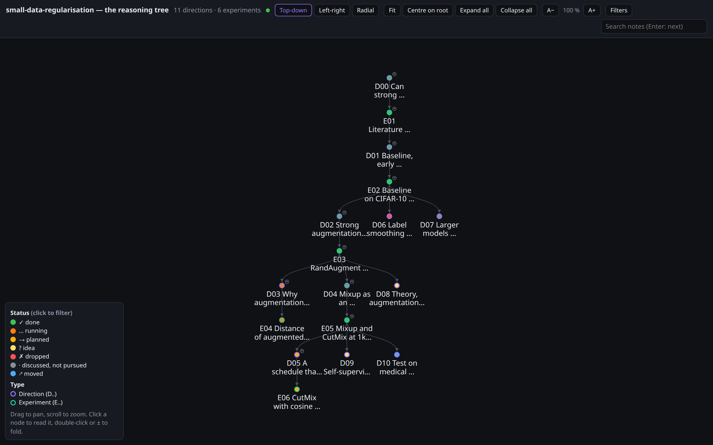
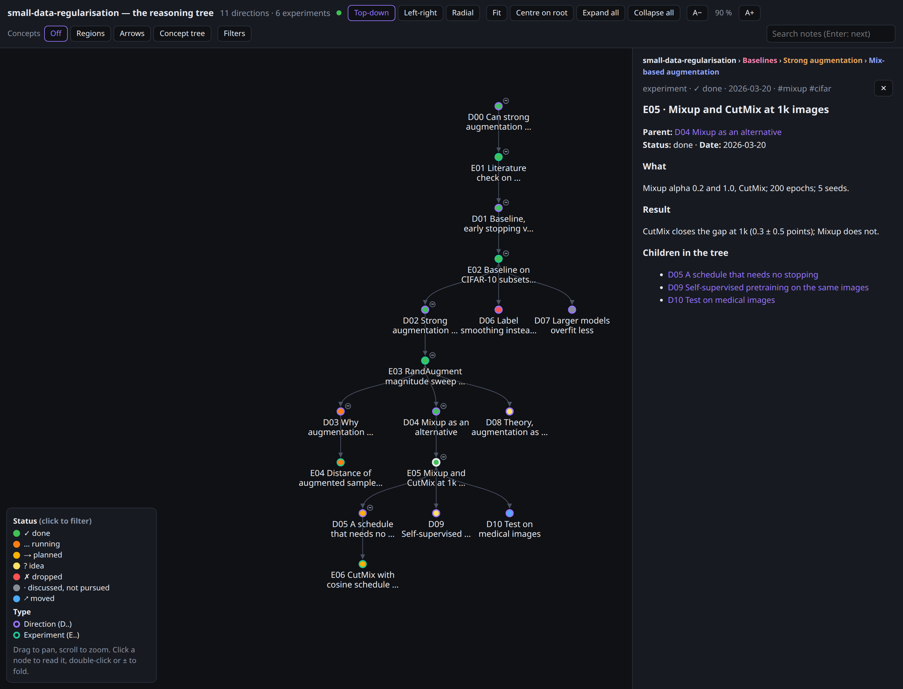
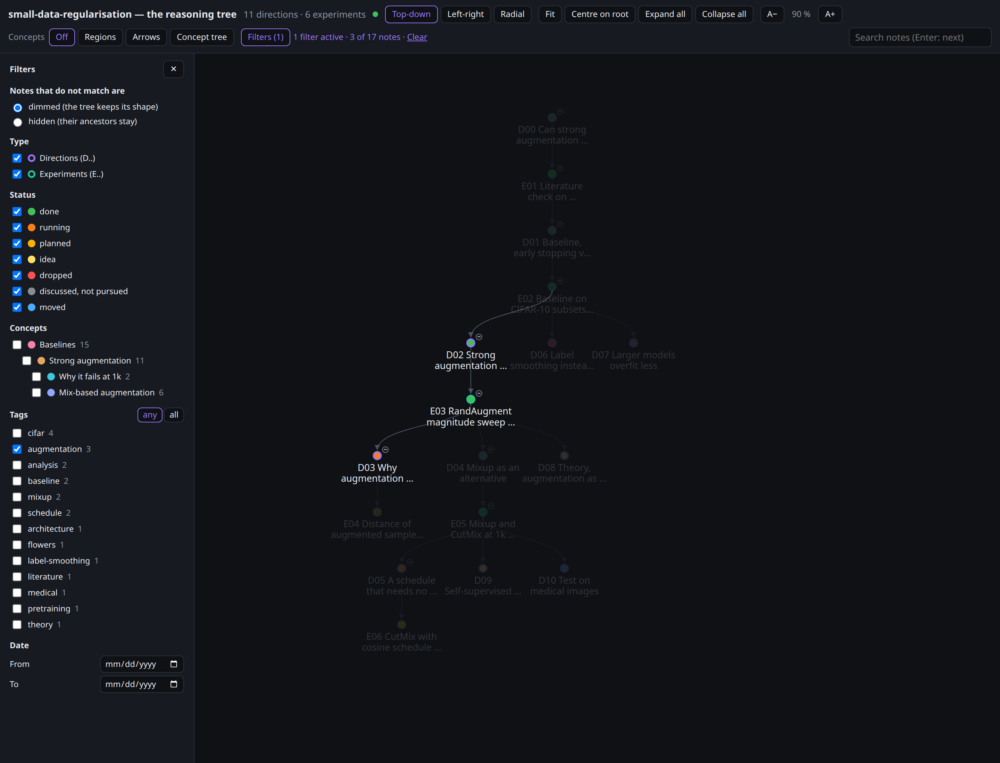
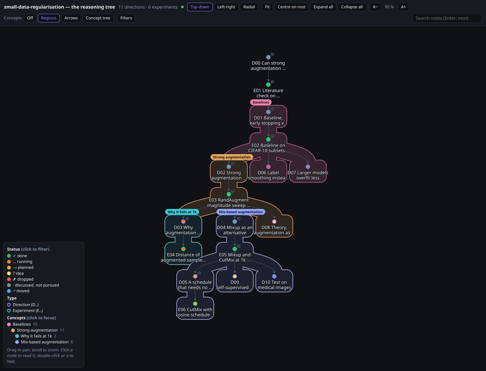
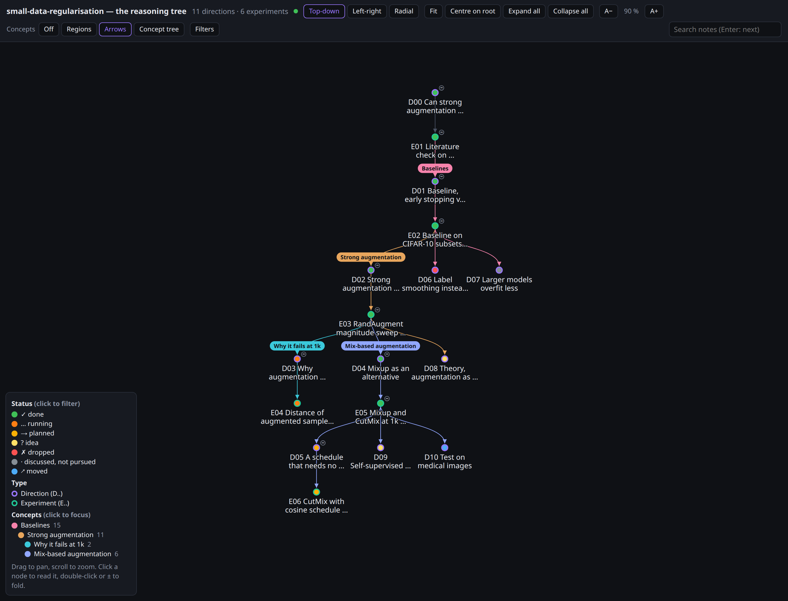
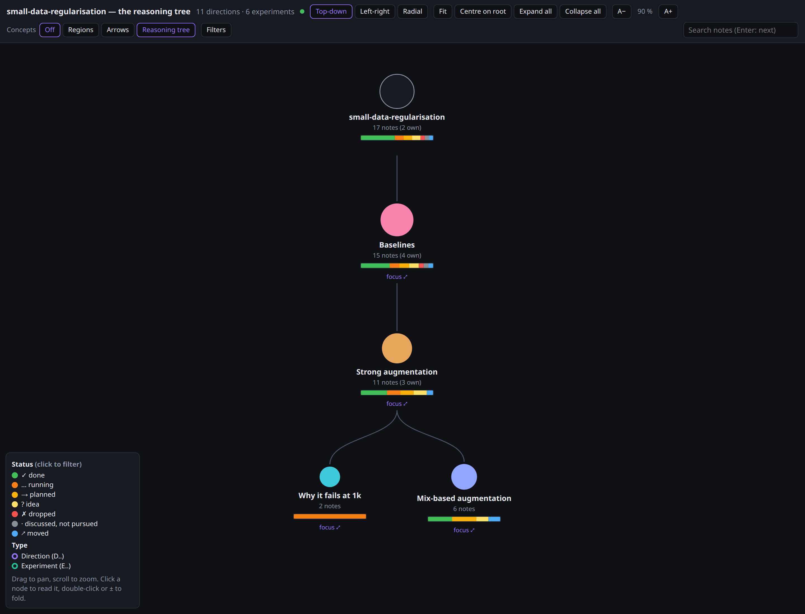

# rft — Reasoning Flow Tree for Claude Code

A Claude Code plugin that keeps the reasoning of a research project readable: **one note per
experiment and one per idea, linked parent → children as a tree**, kept up to date by Claude as
it works, and shown live: as an outline in a pane next to the conversation, and as an
interactive tree (pan, zoom, click a node to read it) in a browser.

- **Experiments (E..)**: something run or computed that produced a result.
- **Directions (D..)**: ideas, questions, hypotheses, including the ones rejected, so the tree
  also says why a path was not taken. **D00** is the starting question.
- **References (R..)**: papers, methods and literature reviews that were read: a summary, a
  source that can be checked, and what they mean for the project.
- **Theory (T..)**: the project's own definitions, methods, taxonomies and arguments, built on
  the directions, experiments and references.
- **Concepts**: named lines of research. A note can start one, and its subtree belongs to it
  until a sub-concept starts. Claude proposes them; you confirm. A concept can link the code
  repositories it runs on, and its experiments and directions then say how they relate to that
  code.

The notes are plain, Obsidian-compatible markdown in your repository (`vault/` by default) and
are the source of truth. You never need Obsidian open.



| Click a node to read its note | Filter by tag, type, status or date |
|---|---|
|  |  |

| Concepts as regions | Concepts as coloured arrows | The concept tree |
|---|---|---|
|  |  |  |

_The screenshots show the fictional project in [`examples/demo`](examples/demo): `cd` into it and
run `/rft` to try the view without setting anything up._

## Install

At the prompt of a Claude Code terminal session:

```
/plugin marketplace add GianniMoretti/rft-plugin
/plugin install rft@rft-plugin
```

or in one step, `/plugin install rft --marketplace GianniMoretti/rft-plugin` (answer `y` to
add the marketplace, then pick a scope). Installed at the user scope it is available in every
project, and stays inert in projects where RFT is not activated.

The plugin is a Claude Code *mod* (a hooks module plus a skill): it needs a Claude Code build
with function hooks (2.1.29x or later). The notes, the tools, the outline pane and `/rft-view`
need nothing else. **The live tree view needs Python 3** (`python3` or `python` on `PATH`,
standard library only) for its small local server; without it `/rft` says so and the rest works.

## Usage

### Activate it in a project

```
/rft-init Is there a better way to do X?
```

creates `.rft/config.json` (the per-project marker) and the vault:

```
vault/
  00 Index.md               the whole tree as an indented list, regenerated
  Reasoning tree.canvas     an Obsidian canvas of the tree, regenerated
  experiments/              E01 <title>.md, ...
  directions/               D00 <starting question>.md, ...
  templates/                _experiment.md, _direction.md
```

If `vault/experiments` or `vault/directions` already hold notes, `/rft-init` adopts them as
they are (ids, statuses and the next free id are read from the notes).

### The notes in one folder, the code in others

A session works on the tree of the nearest `.rft/config.json`: in its own folder, else in the
closest folder above it, so the tree is active in every subfolder of the project. When the code
lives apart from the notes, link to the tree instead of starting a second one: a
`.rft/config.json` holding only

```json
{ "tree": "../notes" }
```

makes every session in that folder, or below it, work on the tree in `../notes` (relative to
the folder that holds `.rft/`, or absolute). With the notes in `phd/notes/` and the repositories
under `phd/code/`, one link in `phd/code/.rft/config.json` serves them all: Claude adds and
updates notes in `phd/notes/`, and nothing is written beside the code.

- The nearest config wins: a repository with its own tree below a link keeps its own.
- A link points at the tree's own folder, not at another link; one that leads nowhere leaves
  RFT off and says why, at session start, in the pane and on `/rft`.
- `/rft-init` starts no second tree in a folder that already works on one.
- Claude's own Read and Edit tools ask before touching files outside the session's folder;
  start the session with `--add-dir <the tree's folder>` to let them read notes freely.
- Sessions in different repositories can add notes to the same tree: ids are taken from the
  notes and the config as they are on disk at that moment.

### What changes once it is active

- **At session start** Claude receives short operating rules and a compact copy of the tree
  (grouped by concept once there are concepts), so it knows to create an experiment's node
  *before* launching it, record only real results, add a direction for every new idea, and
  propose a concept when a new line of research opens (and ask whether code for it exists). A
  session started inside a concept's repo is told which concept that code belongs to. The full
  manual is the `rft-manual` skill.
- **Tools** Claude calls to keep the tree consistent:

  | tool | does |
  |---|---|
  | `rft_add_node` | creates a note with the next free id, a sanitised title (no `^ # \| [ ]`), the template sections, and links it under its parent |
  | `rft_set_status` | changes a status (frontmatter, tag, Status line), optionally appending results or the reason |
  | `rft_set_tags` | replaces a note's topical tags (lowercase kebab-case), keeping the project, type and status tags |
  | `rft_set_type` | changes the type of a note made with the wrong one: the next free id of the new type, the file moved to that type's folder, the type's sections (no text lost), every link to it renamed |
  | `rft_tags` | lists the topical tags in use with counts, so Claude reuses them |
  | `rft_set_concept` | sets, renames or removes (name null) the concept a note starts, once you confirm it |
  | `rft_concepts` | prints the concept tree: names, start notes, counts, statuses and linked code |
  | `rft_set_repos` | links code repositories to a concept (or, on the root note, to the whole project), once you give the path |
  | `rft_code` | a note's code context: its repos by priority, the commit it was last checked against, and the commits and files changed since |
  | `rft_set_code` | writes or updates a note's `## Code` section (how it relates to the code, how to reproduce its results), recording each repo's current commit |
  | `rft_tree` | prints the tree or a subtree |
  | `rft_validate` | checks ids, types, statuses, titles, parents, broken wikilinks, derived fields |
  | `rft_sync` | regenerates children / up / down, the index tree and the canvas after hand edits |
  | `rft_comments` | a note's comments and suggestions, or the notes with open threads |
  | `rft_comment` | replies in a thread (or closes a suggestion it made in the note), or starts a comment on a quote |
  | `rft_suggest` | proposes new text for a quote, or the text an open suggestion asks for; you accept or reject it |

- **The outline pane** opens as a sidebar at session start in the terminal and VS Code where the
  surface docks panes (turn this off with the `autoOpen` option), and with `/rft list`: an indented, coloured outline of the tree, the same on
  the desktop app, VS Code and the terminal. Click a node to read its note, ▾ / ▸ to fold a
  branch. It refreshes by itself when notes change, whoever changed them, and shows the tree
  view's address while its server runs.

### The tree view

`/rft` also starts a small local server for the interactive tree view.

- **On the desktop app** it tries to open the view in the app's built-in browser pane, reusing
  the tab already on it. When the plugin cannot reach the browser pane (the usual case today),
  it prints the address and opens the outline pane: click the address and choose to open it in
  the app.
- **In the terminal and elsewhere** it prints the address, e.g. `http://127.0.0.1:41234/?token=…`, and
  opens the outline pane. Open the address in any browser on the same machine.

- A tidy tree, **top-down**, **left-right** or **radial** (never a force layout): circles
  filled by status and ringed by type, arrows from parent to child. The layout button shows
  the current layout as a symbol and switches to the next one.
- An infinite canvas: drag to pan, scroll or pinch to zoom. One button fits the whole tree,
  then centres on the root; panning or zooming by hand makes it fit again.
  Labels show more of the title the closer you zoom.
- The title is the project's name, or the root note's concept when it declares one.
- Click a node to read its note in a side drawer; links in the note jump to their node. LaTeX
  renders as in Obsidian: `$…$` inline, `$$…$$` displayed (on one line or several); a `$` in
  code, `\$`, and amounts like "$5 and $10" stay text.
- Images show as in Obsidian: `![[name.png]]` and ``, with a width as
  `![[name.png|400]]` or `` (or `400x300`). A path is read from the note's folder or
  the vault's top, or is a path on disk (`/home/…/results/fig.png`); a bare name is the image of
  that name nearest the note, in the vault, else in the Obsidian vault around it (the folder
  holding `.obsidian/`), so `![[Pasted image ….png]]` finds Obsidian's attachments. An image
  outside the vault needs the key (see below); a missing one says so in its place. Click an image
  to open it at full size. A remote image (`https://…`) shows as a link: the page loads nothing
  from elsewhere. `rft_validate` leaves embedded images alone. `/rft-view` shows each image as
  a placeholder.
- **Edit** (the pencil in the drawer) changes the note's text: the markdown below the
  frontmatter (status, parent and tags stay with Claude's tools). **Save** or Ctrl/Cmd+S writes the file, **Cancel**
  or Esc drops the changes. A note that changed meanwhile (Claude, another editor) is never
  overwritten silently: you choose **Overwrite** or **Reload**. Leaving a note with unsaved
  changes asks first.
  Fold a branch with its **−** / **+** badge or a double-click; one button expands every
  branch while one is folded, and collapses them all otherwise.
- **Add child** (a node with a **+**, in the drawer) adds a direction or an experiment under
  the note shown: choose the type (the other one than the note's comes first), type a title,
  **Add** or Enter. The note is
  made as Claude's `rft_add_node` makes it (the next free id, the title cleaned, the template,
  the default status, linked under its parent, the index and canvas regenerated), by the plugin
  in the session that ran `/rft`, so it costs no model turn and no tokens; it then opens in
  **Edit**.
- **Change type** (a ring in a turning arrow, in the drawer) changes the type of a note made
  with the wrong one: choose the type, **Change**. The note gets the next free id of that type and moves to its folder; its text
  stays, the type's missing sections are added, and every link to it is renamed. Like
  **Add child**, the session that ran `/rft` does it with `rft_set_type`'s code, at no model turn.
  The root stays a direction.
- **Footnotes** show as in a book's margin: a mark `[^1]` in the text, its text on a line
  `[^1]: …` (indented lines continue it), or inline `^[…]`, as Obsidian writes them. Each mark is
  numbered in reading order and has a number in the drawer's right margin; hover either (or tap
  it) to read the footnote, links and LaTeX included. Select text and choose **Footnote** to add
  one: its mark goes after the selection, its text at the end of the note.
- **Comments and suggestions**, as in Overleaf, discuss a part of a note before anyone edits it.
  Select text in the drawer and choose:
  - **Comment**: a question or remark on that text;
  - **Suggest**: new text for it (the markdown as written, to change), or, with the text left
    as it is, what should change in words, for Claude to write.

  Open threads are marked in the text (a suggestion as the old text struck through and the new
  text after it) and listed under the note, where you **Reply**, **Resolve** a comment, **Accept**
  a suggestion (its new text is written into the note) or **Reject** it. Closed threads stay in
  the note's **History**, and **Reopen** brings one back.
  - **Ask Claude** (on a thread, or **Post and ask Claude** / **Post and suggest** when posting) sends the thread to the session that
    ran `/rft`, as a turn of its own. Claude answers only when asked. It answers in the thread: a
    comment gets a reply and no edit. A suggestion on a note that is not locked is made in the
    note and closed as *applied*. On a locked note Claude writes the new text as a suggestion
    for you to accept.
  - A thread keeps its quote and the text around it, so it is found again after the note is
    edited. When the quoted text itself changed, the thread says what it now reads, and its
    suggestion can no longer be accepted. When the text is gone, the thread says so.
  - The threads live beside the notes, one file per note: `vault/.comments/<id>.json`, a dot
    folder Obsidian leaves alone. They follow a note whose type (and id) changes.
- **Lock** (the padlock in the drawer) makes a note yours: `locked: true` in its frontmatter.
  Claude then changes nothing in its text, only suggests changes, which you accept. The plugin
  refuses Claude's Edit and Write on a locked note, shell commands that write to it and name its
  file (as far as a command shows that), and `rft_set_status` notes and `rft_set_code` on it.
  Status, tags and the tree's derived fields still change. Your own edits in the drawer are not
  affected, and neither are Obsidian's.
- Hover a node to highlight its path to the root; **search** (Enter jumps to the next match).
- **Filters** opens a side panel: topical tags (with counts, matching **any** or **all**), type,
  status (the same filter as clicking the legend), and a date range. Notes that do not match
  are dimmed, keeping the tree's shape, or hidden, keeping every ancestor of a match so the tree
  stays connected. The toolbar shows how many filters are on, with **Clear**.
- **A−** / **A+** set the size of the labels and the note text.
- The sun / moon button switches between light and dark. Until it is used the view follows the
  system's theme; then it keeps the choice, for every project.
- It follows the vault live, and keeps the zoom, layout, folds, filters and text size between
  visits.

### Concepts

A **concept** is a line of research: the note that starts it (usually the direction that opened
the line) and its whole subtree, until a descendant starts a sub-concept. Concepts nest; notes
with no concept above them belong to the project itself. A concept on the root note covers the
whole tree, so it takes the project's place at the top of the concept tree. Concepts live in
the starting note's frontmatter:

```yaml
concept: "Strong augmentation"
concept_summary: "Whether heavy augmentation alone closes the small-data gap"
```

Concepts are explicit. Claude proposes one when a direction opens a new line of research, and
applies it with `rft_set_concept` only after you say yes. `/rft-concepts suggest` asks Claude for
a full split of the existing tree, as a table to confirm or change; `/rft-concepts` prints the
concept tree.

In the tree view, the concept button switches the overlay from off to **Regions** to
**Arrows** and back; its symbol shows the current one:

- **Regions**: a soft region behind each concept, bordered in its colour, its name on top;
  sub-concepts are nested, lighter regions. They follow the layout (top-down, left-right,
  radial), folded branches and hidden filters.
- **Arrows**: links coloured by the concept of the note they lead to, and a name badge at each
  concept's start.
- Concept colours are a palette of their own, apart from the status colours; a concept legend
  shows while the overlay is on. It lists the top-level concepts, each with an arrow that
  unfolds its sub-concepts, and the whole legend folds to one line (**Legend ▸**).
- **Concept tree** shows a tree of the concepts: each sized by its notes, with a bar of their
  statuses, in the same layout as the reasoning tree (top-down, left-right or radial). Click one to go back to the reasoning tree on its start note, its region briefly
  highlighted; **focus** shows only that concept's subtree.
- **Focus** is also reachable from the legend, a badge, and the concept path at the top of the
  note drawer; a breadcrumb (project › concept › sub-concept, or from the root note's concept when it has
  one) leads back up.
- Concepts are also a filter in **Filters**.

A link can open the view in a given state, e.g. `?layout=lr&concepts=regions`,
`?view=concepts`, or `?focus=D02&note=E05`.

### Code repos

A concept can link the code it runs on: one or more repositories on the machine, in its
starting note.

```yaml
concept: "Schedule-free training"
concept_summary: "Training without a stopping rule"
concept_repos: ["/home/me/code/sfree", "../code/train-utils"]
```

Paths are absolute, `~/…`, or relative to the tree's folder (the one holding `.rft/`). On the
root note, `concept_repos` is the code of the whole project.

- **Priority.** A note works with its own concept's repos first, then with those inherited from
  the concepts above it. A sub-concept's code is the most specific.
- **When a concept is created**, Claude asks whether code for it already exists, and where, and
  links it with `rft_set_repos`. It then reads the code and gives the concept's experiments and
  directions a `## Code` section. `rft_set_repos` also says whether sessions started in the repo
  reach the tree; when they don't, it names the `.rft/config.json` link that would fix that, and
  Claude asks before writing it.
- **The `## Code` section** says how the note relates to the code: entry points, files,
  functions, configs, what has to change. A direction gets a short pointer. It opens with one
  line per repo, written by the plugin from git, holding the commit the references were checked
  against:

  ```
  ## Code
  - `/home/me/code/sfree` @ 3f2a1c9d0e (main) · checked 2026-11-06
  - `../code/train-utils` @ a1b2c3d4e5 (main) · checked 2026-11-06 · inherited from Strong augmentation

  Entry point `train.py --schedule free`, config `configs/cifar_1k.yaml`; needs a new
  `--no-early-stop` flag in `train.py`.

  **Reproduce:** at 3f2a1c9d0e: `python train.py --config configs/cifar_1k.yaml --seed 0 1 2`;
  raw outputs in `runs/E08/`, aggregated with `tools/summary.py`.
  ```

- **The code as it is now comes first.** Before working on an experiment, Claude calls
  `rft_code`. It shows the commits and changed files since the note was last checked, uncommitted
  changes included. Claude reads those changes, updates the references, and `rft_set_code`
  records the current commits. Plans and proposed changes start from the current code, not from
  an older note's commit.
- **Results live in the experiment's note.** Each repo stores its outputs its own way. Claude
  processes them and writes the numbers in **Result**, and the Reproduce part says how to get
  them again: the commit of the run, the command and config, where the raw outputs are, and how
  they were processed. That commit stays fixed when the references are checked again later.
- `rft_validate` warns about a repo that is missing or not under git, `concept_repos` on a note
  that starts no concept, and a Code section that is missing or names a repo the concept no
  longer links.
- The tree view shows a note's code under its concept path in the drawer, with inherited repos
  marked as such. The concept tree names each concept's repos.

Every note carries 1–3 **topical tags** besides the project, type and status ones (the manual
asks Claude to reuse the vocabulary `rft_tags` lists); the tree's `api/tree` JSON lists them with
their counts.

The server listens on `127.0.0.1` only, on a free port (or `webPort` in the config). It serves
the page, the tree as JSON and the text of one note at a time, read by its id from inside the
vault, and the image files notes embed: one inside the vault to anyone who can read the notes,
one outside it (anywhere on disk) only to the page carrying the key below, so another user of
the machine cannot read your files through it, nor learn whether one exists. An image is sent
with a policy that runs nothing in it, an SVG's scripts included. It answers only requests for
a loopback host name. It writes a note's text from **Edit**, **Footnote** or an accepted
suggestion, its frontmatter kept as it is; the `locked:` line from the padlock; and a note's
comments file in `vault/.comments/`. A new note from **Add child**, or a note's new type from
**Change type**, it asks the session that started it to make, and **Ask Claude** to answer (a
line on its output, which the plugin reads). It does any of these only for
the page itself carrying the project's key, which the address `/rft` prints holds (`?token=…`):
neither another web page nor another user of the machine can change or add a note. Open that address once and the browser
remembers the key, which stays the same across restarts (kept, readable by you alone, in
`~/.cache/rft/keys/`), so the plain address or a bookmark can edit too. It stops with
the session or `/rft stop`; `/rft` again reuses it. Sessions on the same tree with the same
`webPort` share one address, key included: a second session's `/rft` prints it, and its server
takes the port over when the first session ends; a port held by anything else gets a free one
instead. On a **remote machine** (SSH, a cluster
node), forward the port and open the address on your own machine:

```bash
ssh -L 41234:127.0.0.1:41234 user@remote
```

d3 (ISC licence, `web/vendor/LICENSE-d3.txt`) and KaTeX (MIT licence,
`web/vendor/LICENSE-katex.txt`; its fonts inlined in its stylesheet) are bundled, so the page
needs no network.

### Commands

| command | does |
|---|---|
| `/rft` | start (or reuse) the tree view server and show it: in the desktop's browser pane, else print its address and open the outline pane |
| `/rft list` | open the outline pane |
| `/rft stop` | stop the tree view server |
| `/rft text` | print the tree in the transcript |
| `/rft-init [starting question]` | activate RFT here and create (or adopt) the vault |
| `/rft-concepts` | print the concept tree |
| `/rft-concepts suggest` | ask Claude to propose a concept split; nothing changes until you confirm |
| `/rft-view` | write `vault/tree.html`: the same tree view as one standalone file, every note inside (images as placeholders), to open anywhere or share |

The plugin registers these commands when a session starts, so the desktop app's slash-command
menu may not list them (it lists the plugin's skill, `/rft:rft-manual`): type `/rft` in full
and it runs. The terminal's typeahead lists them.

### Statuses

`planned` →, `running` …, `done` ✓, `idea` ?, `dropped` ✗, `discussed` · (not pursued),
`moved` ↗.

### Configuration

`.rft/config.json`:

```json
{ "version": 1, "vault": "vault", "project": "my-project", "canvas": true, "mermaid": false,
  "lastId": { "E": 12, "D": 9 }, "webPort": 0 }
```

`mermaid: true` also writes `Reasoning tree (diagram).md`, a Mermaid flowchart Obsidian draws
natively. `lastId` keeps ids from being reused after a note is deleted. `webPort` fixes the
tree view's port (0: a free one), handy for a standing `ssh -L` forward. A config that holds
only `tree` is a link to a tree in another folder (see above). The code a concept runs on is
linked in its note, not in the config (see Code repos).

### Obsidian, if you use it

Every note keeps `up:` / `down:` (the parent and the children), the default fields of the
Breadcrumbs plugin, so its tree view works without configuration; `Reasoning tree.canvas` is a
native Obsidian canvas whose hand-moved cards keep their place.

## Development

```bash
claude plugin validate .
claude plugin test .
python3 -m unittest discover -s tests -p "test_*.py"
claude --plugin-dir .
```

The first two check and test the mod, the third tests the server, and the last starts a
session with the plugin loaded from this folder.

- `hooks/register.tsx`: the hooks module (commands, tools, prompt injection, the outline pane,
  the server's lifecycle).
- `hooks/lib/vault.ts`: the vault model; `hooks/lib/ops.ts` the operations; `hooks/lib/page.ts`
  the standalone page.
- `hooks/lib/comments.ts`: comments, suggestions and locked notes, as Claude's tools see them.
- `web/`: the tree view (`index.html`, `app.js`, `app.css`; `filters.js`, `layout.js` and
  `concepts.js` hold the pure filter, radial layout and concept logic; `markdown.js` the note
  renderer, footnotes and the map from the page back to the note's text; `theme.js` the light and
  dark themes; vendored d3), one codebase for the live view and `/rft-view`, which shows the
  threads read-only.
- `server/rft_server.py`: the local server (Python standard library).
- `skills/rft-manual/SKILL.md`: the manual; `tests/`: the mod's tests on an in-memory vault, the
  outline pane on every surface, and the server's tests.

## License

MIT
