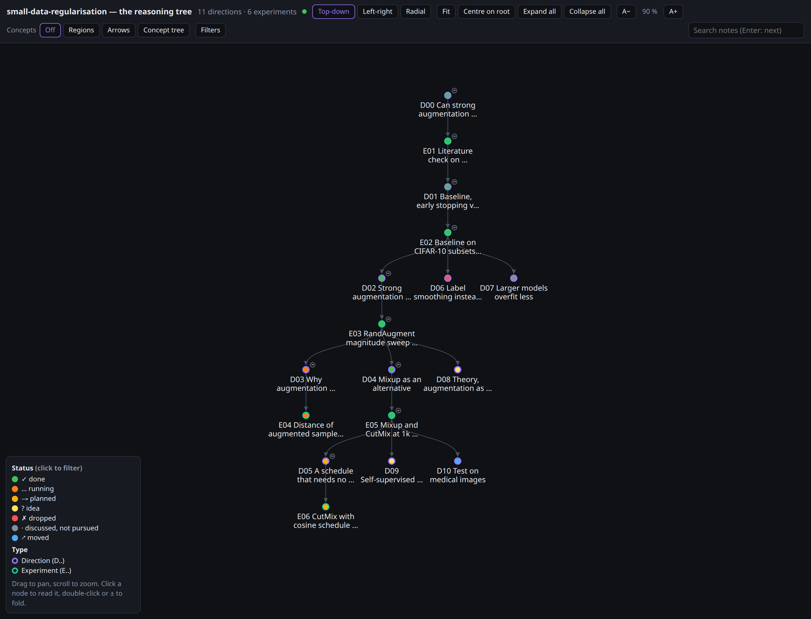
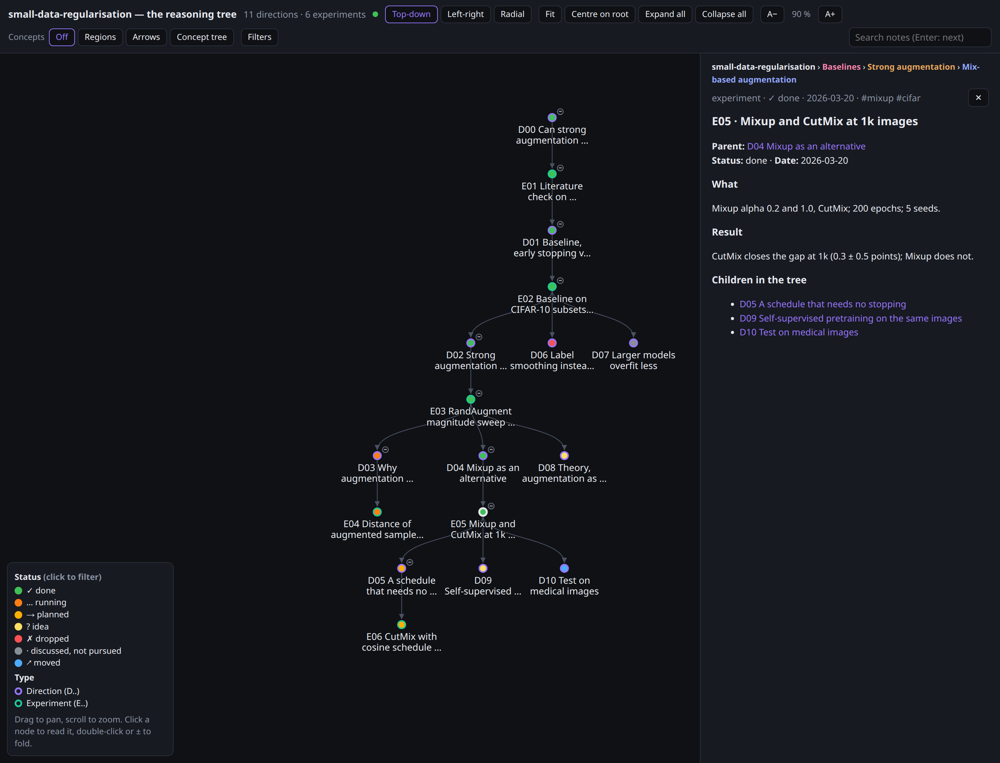
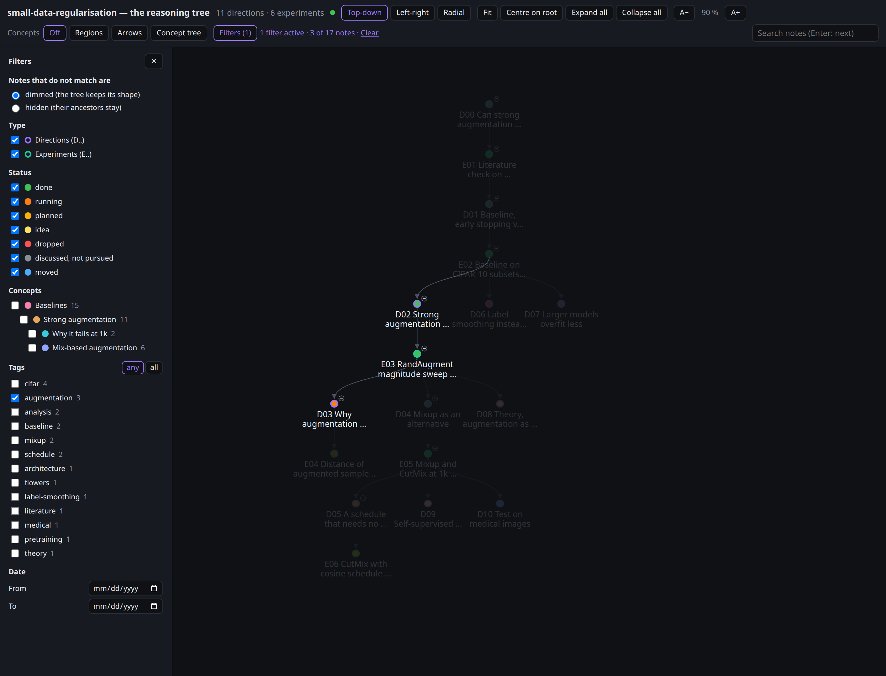
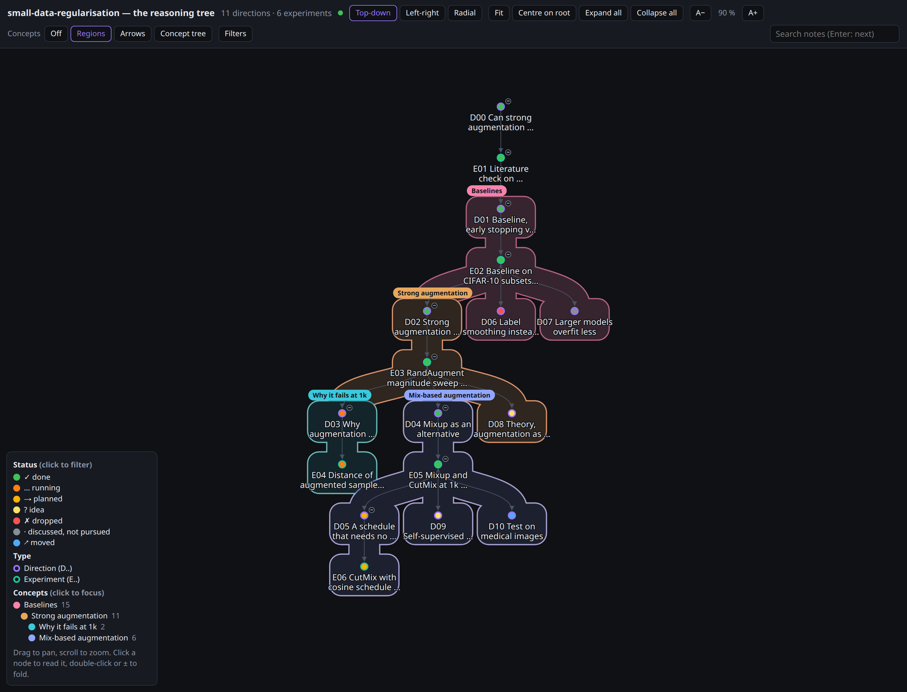
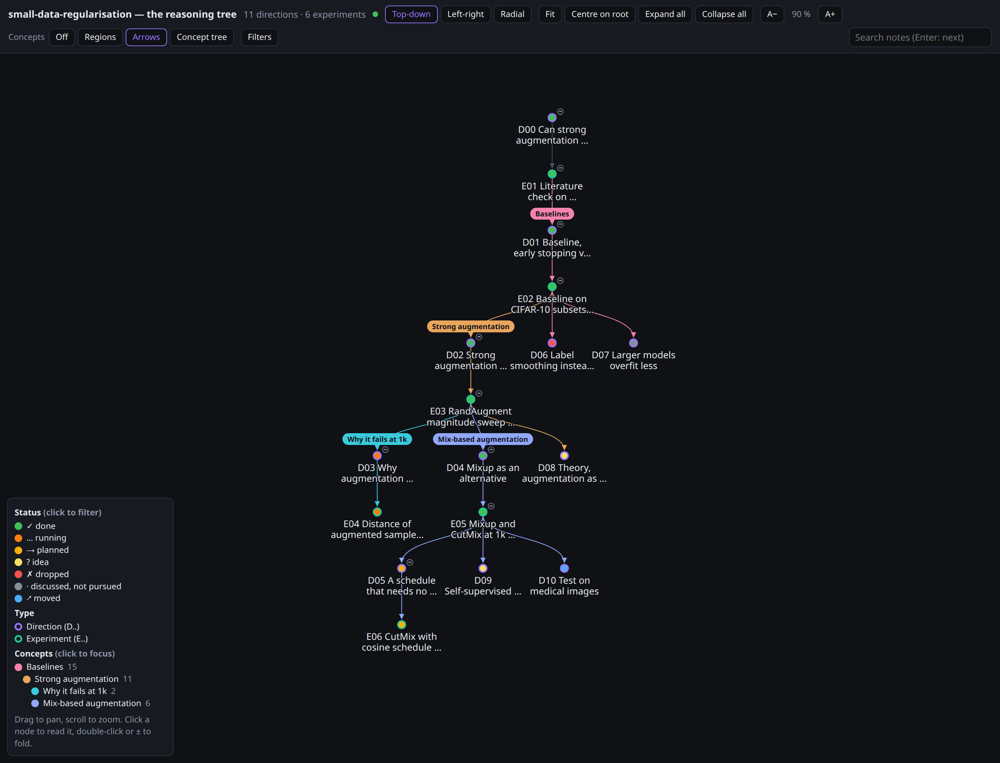
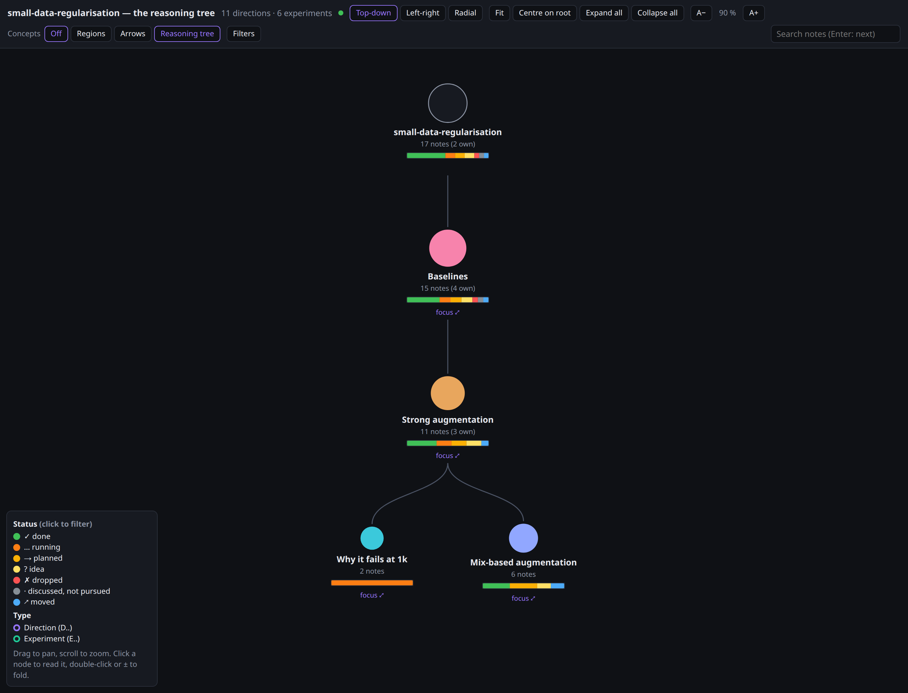

# rft — Reasoning Flow Tree for Claude Code

A Claude Code plugin that keeps the reasoning of a research project readable: **one note per
experiment and one per idea, linked parent → children as a tree**, kept up to date by Claude as
it works, and shown live: as an outline in a pane next to the conversation, and as an
interactive tree (pan, zoom, click a node to read it) in a browser.

- **Experiments (E..)**: something run or computed that produced a result.
- **Directions (D..)**: ideas, questions, hypotheses, including the ones rejected, so the tree
  also says why a path was not taken. **D00** is the starting question.
- **Concepts**: named lines of research. A note can start one, and its subtree belongs to it
  until a sub-concept starts. Claude proposes them; you confirm.

The notes are plain, Obsidian-compatible markdown in your repository (`vault/` by default) and
are the source of truth. You never need Obsidian open.



| Click a node to read its note | Filter by tag, type, status or date |
|---|---|
|  |  |

| Concepts as regions | Concepts as coloured arrows | The concept tree |
|---|---|---|
|  |  |  |

_The screenshots show the fictional project in [`examples/demo`](examples/demo): `cd` into it and
run `/rft` to try the view without setting anything up._

## Install

At the prompt of a Claude Code terminal session:

```
/plugin marketplace add GianniMoretti/rft-plugin
/plugin install rft@rft-plugin
```

or in one step, `/plugin install rft --marketplace GianniMoretti/rft-plugin` (answer `y` to
add the marketplace, then pick a scope). Installed at the user scope it is available in every
project, and stays inert in projects where RFT is not activated.

The plugin is a Claude Code *mod* (a hooks module plus a skill): it needs a Claude Code build
with function hooks (2.1.29x or later). The notes, the tools, the outline pane and `/rft-view`
need nothing else. **The live tree view needs Python 3** (`python3` or `python` on `PATH`,
standard library only) for its small local server; without it `/rft` says so and the rest works.

## Usage

### Activate it in a project

```
/rft-init Is there a better way to do X?
```

creates `.rft/config.json` (the per-project marker) and the vault:

```
vault/
  00 Index.md               the whole tree as an indented list, regenerated
  Reasoning tree.canvas     an Obsidian canvas of the tree, regenerated
  experiments/              E01 <title>.md, ...
  directions/               D00 <starting question>.md, ...
  templates/                _experiment.md, _direction.md
```

If `vault/experiments` or `vault/directions` already hold notes, `/rft-init` adopts them as
they are (ids, statuses and the next free id are read from the notes).

### What changes once it is active

- **At session start** Claude receives short operating rules and a compact copy of the tree
  (grouped by concept once there are concepts), so it knows to create an experiment's node
  *before* launching it, record only real results, add a direction for every new idea, and
  propose a concept when a new line of research opens. The full manual is the `rft-manual` skill.
- **Tools** Claude calls to keep the tree consistent:

  | tool | does |
  |---|---|
  | `rft_add_node` | creates a note with the next free id, a sanitised title (no `^ # \| [ ]`), the template sections, and links it under its parent |
  | `rft_set_status` | changes a status (frontmatter, tag, Status line), optionally appending results or the reason |
  | `rft_set_tags` | replaces a note's topical tags (lowercase kebab-case), keeping the project, type and status tags |
  | `rft_tags` | lists the topical tags in use with counts, so Claude reuses them |
  | `rft_set_concept` | sets, renames or removes (name null) the concept a note starts, once you confirm it |
  | `rft_concepts` | prints the concept tree: names, start notes, counts and statuses |
  | `rft_tree` | prints the tree or a subtree |
  | `rft_validate` | checks ids, types, statuses, titles, parents, broken wikilinks, derived fields |
  | `rft_sync` | regenerates children / up / down, the index tree and the canvas after hand edits |

- **The outline pane** opens as a sidebar at session start in the terminal and VS Code where the
  surface docks panes (turn this off with the `autoOpen` option), and with `/rft list`: an indented, coloured outline of the tree, the same on
  the desktop app, VS Code and the terminal. Click a node to read its note, ▾ / ▸ to fold a
  branch. It refreshes by itself when notes change, whoever changed them, and shows the tree
  view's address while its server runs.

### The tree view

`/rft` also starts a small local server for the interactive tree view.

- **On the desktop app** it tries to open the view in the app's built-in browser pane, reusing
  the tab already on it. When the plugin cannot reach the browser pane (the usual case today),
  it prints the address and opens the outline pane: click the address and choose to open it in
  the app.
- **In the terminal and elsewhere** it prints the address, e.g. `http://127.0.0.1:41234/`, and
  opens the outline pane. Open the address in any browser on the same machine.

- A tidy tree, **top-down**, **left-right** or **radial** (never a force layout): circles
  filled by status and ringed by type, arrows from parent to child.
- An infinite canvas: drag to pan, scroll or pinch to zoom; **Fit** and **Centre on root**.
  Labels show more of the title the closer you zoom.
- Click a node to read its note in a side drawer; links in the note jump to their node.
  Fold a branch with its **−** / **+** badge or a double-click; **Expand all**, **Collapse all**.
- Hover a node to highlight its path to the root; **search** (Enter jumps to the next match).
- **Filters** opens a side panel: topical tags (with counts, matching **any** or **all**), type,
  status (the same filter as clicking the legend), and a date range. Notes that do not match
  are dimmed, keeping the tree's shape, or hidden, keeping every ancestor of a match so the tree
  stays connected. The toolbar shows how many filters are on, with **Clear**.
- **A−** / **A+** set the size of the labels and the note text.
- It follows the vault live, and keeps the zoom, layout, folds, filters and text size between
  visits.

### Concepts

A **concept** is a line of research: the note that starts it (usually the direction that opened
the line) and its whole subtree, until a descendant starts a sub-concept. Concepts nest; notes
with no concept above them belong to the project itself. They live in the starting note's
frontmatter:

```yaml
concept: "Strong augmentation"
concept_summary: "Whether heavy augmentation alone closes the small-data gap"
```

Concepts are explicit. Claude proposes one when a direction opens a new line of research, and
applies it with `rft_set_concept` only after you say yes. `/rft-concepts suggest` asks Claude for
a full split of the existing tree, as a table to confirm or change; `/rft-concepts` prints the
concept tree.

In the tree view, **Concepts: Off / Regions / Arrows** switches the overlay:

- **Regions**: a soft region behind each concept, bordered in its colour, its name on top;
  sub-concepts are nested, lighter regions. They follow the layout (top-down, left-right,
  radial), folded branches and hidden filters.
- **Arrows**: links coloured by the concept of the note they lead to, and a name badge at each
  concept's start.
- Concept colours are a palette of their own, apart from the status colours; a concept legend
  shows while the overlay is on.
- **Concept tree** shows a tree of the concepts: each sized by its notes, with a bar of their
  statuses. Click one to go back to the reasoning tree on its start note, its region briefly
  highlighted; **focus** shows only that concept's subtree.
- **Focus** is also reachable from the legend, a badge, and the concept path at the top of the
  note drawer; a breadcrumb (project › concept › sub-concept) leads back up.
- Concepts are also a filter in **Filters**.

A link can open the view in a given state, e.g. `?layout=lr&concepts=regions`,
`?view=concepts`, or `?focus=D02&note=E05`.

Every note carries 1–3 **topical tags** besides the project, type and status ones (the manual
asks Claude to reuse the vocabulary `rft_tags` lists); the tree's `api/tree` JSON lists them with
their counts.

The server is read-only and listens on `127.0.0.1` only, on a free port (or `webPort` in the
config). It serves the page, the tree as JSON and the text of one note at a time, read by its
id from inside the vault, and answers only requests for a loopback host name. It stops with
the session or `/rft stop`; `/rft` again reuses it. On a **remote machine** (SSH, a cluster
node), forward the port and open the address on your own machine:

```bash
ssh -L 41234:127.0.0.1:41234 user@remote
```

d3 (ISC licence, `web/vendor/LICENSE-d3.txt`) is bundled, so the page needs no network.

### Commands

| command | does |
|---|---|
| `/rft` | start (or reuse) the tree view server and show it: in the desktop's browser pane, else print its address and open the outline pane |
| `/rft list` | open the outline pane |
| `/rft stop` | stop the tree view server |
| `/rft text` | print the tree in the transcript |
| `/rft-init [starting question]` | activate RFT here and create (or adopt) the vault |
| `/rft-concepts` | print the concept tree |
| `/rft-concepts suggest` | ask Claude to propose a concept split; nothing changes until you confirm |
| `/rft-view` | write `vault/tree.html`: the same tree view as one standalone file, every note inside, to open anywhere or share |

The plugin registers these commands when a session starts, so the desktop app's slash-command
menu may not list them (it lists the plugin's skill, `/rft:rft-manual`): type `/rft` in full
and it runs. The terminal's typeahead lists them.

### Statuses

`planned` →, `running` …, `done` ✓, `idea` ?, `dropped` ✗, `discussed` · (not pursued),
`moved` ↗.

### Configuration

`.rft/config.json`:

```json
{ "version": 1, "vault": "vault", "project": "my-project", "canvas": true, "mermaid": false,
  "lastId": { "E": 12, "D": 9 }, "webPort": 0 }
```

`mermaid: true` also writes `Reasoning tree (diagram).md`, a Mermaid flowchart Obsidian draws
natively. `lastId` keeps ids from being reused after a note is deleted. `webPort` fixes the
tree view's port (0: a free one), handy for a standing `ssh -L` forward.

### Obsidian, if you use it

Every note keeps `up:` / `down:` (the parent and the children), the default fields of the
Breadcrumbs plugin, so its tree view works without configuration; `Reasoning tree.canvas` is a
native Obsidian canvas whose hand-moved cards keep their place.

## Development

```bash
claude plugin validate .
claude plugin test .
python3 -m unittest discover -s tests -p "test_*.py"
claude --plugin-dir .
```

The first two check and test the mod, the third tests the server, and the last starts a
session with the plugin loaded from this folder.

- `hooks/register.tsx`: the hooks module (commands, tools, prompt injection, the outline pane,
  the server's lifecycle).
- `hooks/lib/vault.ts`: the vault model; `hooks/lib/ops.ts` the operations; `hooks/lib/page.ts`
  the standalone page.
- `web/`: the tree view (`index.html`, `app.js`, `app.css`; `filters.js`, `layout.js` and
  `concepts.js` hold the pure filter, radial layout and concept logic; vendored d3), one
  codebase for the live view and `/rft-view`.
- `server/rft_server.py`: the read-only local server (Python standard library).
- `skills/rft-manual/SKILL.md`: the manual; `tests/`: the mod's tests on an in-memory vault, the
  outline pane on every surface, and the server's tests.

## License

MIT
