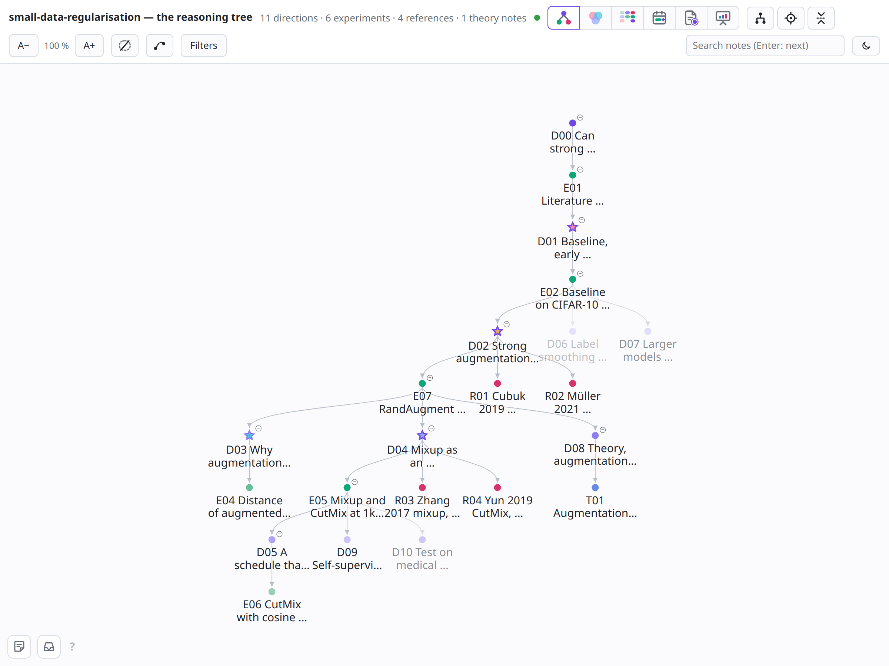
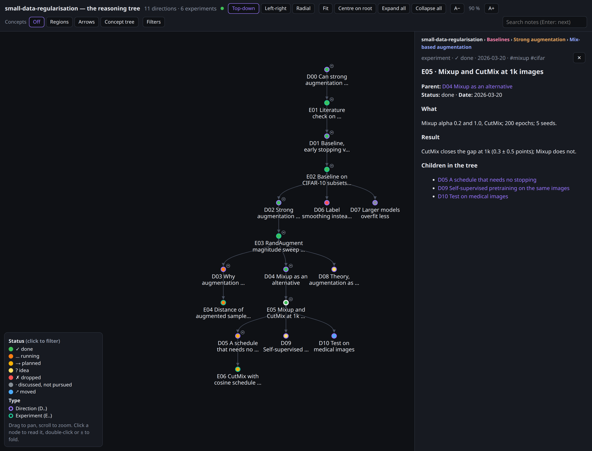
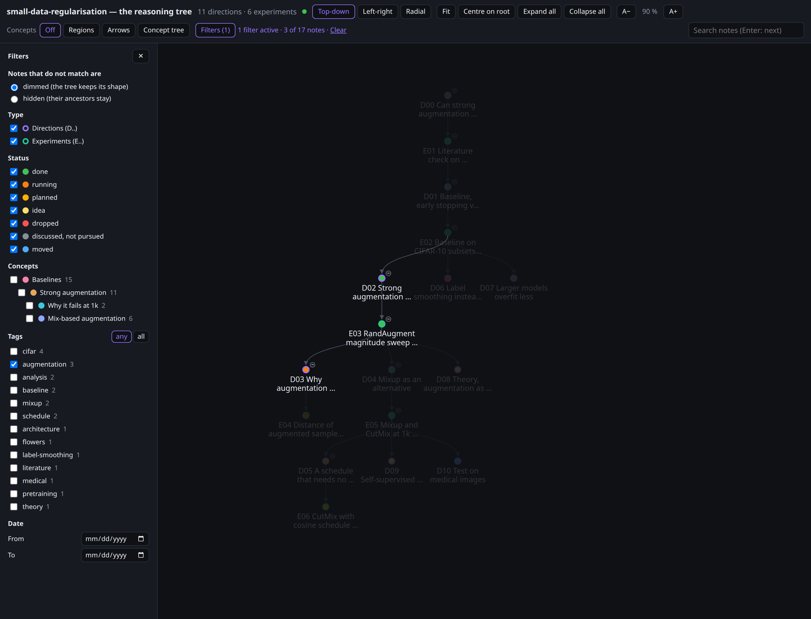
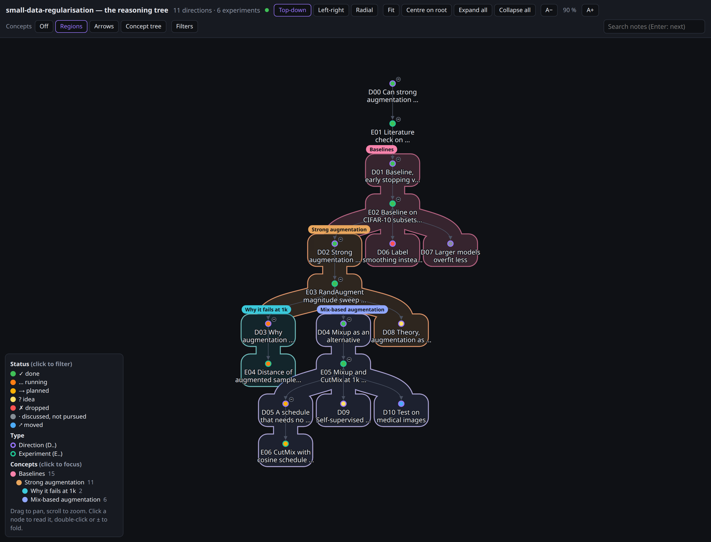
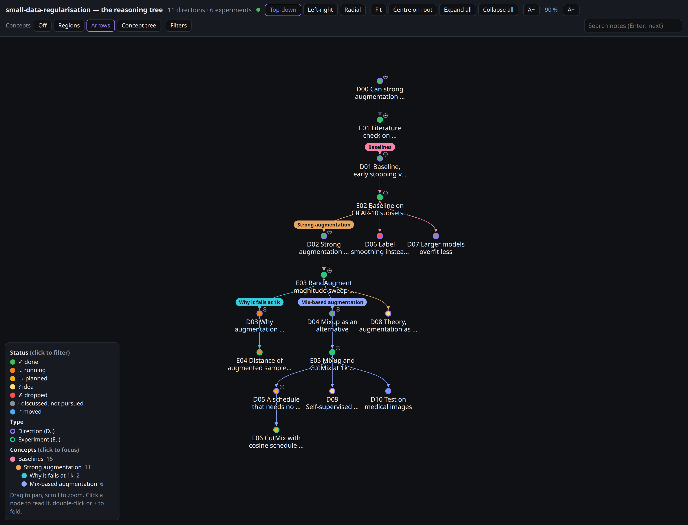
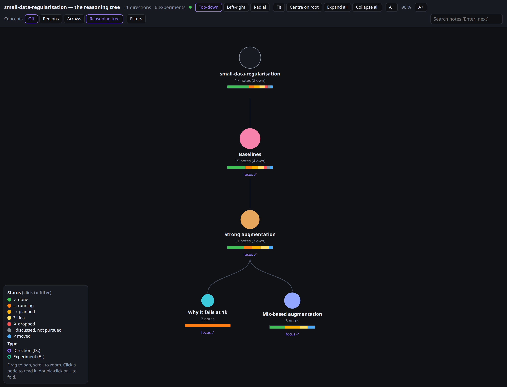

# rft — Reasoning Flow Tree for Claude Code

A Claude Code plugin that keeps the reasoning of a research project readable: **one note per
experiment and one per idea, linked parent → children as a tree**, kept up to date by Claude as
it works, and shown live: as an outline in a pane next to the conversation, and as an
interactive tree (pan, zoom, click a node to read it) in a browser.

- **Experiments (E..)**: something run or computed that produced a result.
- **Directions (D..)**: ideas, questions, hypotheses, including the ones rejected, so the tree
  also says why a path was not taken. **D00** is the starting question.
- **References (R..)**: papers, methods and literature reviews that were read: a summary, a
  source that can be checked, and what they mean for the project. Experiments and directions
  link the references they build on (`refs:`), so every result can be traced to the papers
  behind it. When the work turns to a new field or concept, Claude offers a literature search
  first (`/rft-literature` asks for one directly). A search is written as one **literature
  note** (an R note tagged `literature`, shown in cyan) that lists every paper found; single
  papers get notes of their own only when you choose them.
- **Theory (T..)**: the project's own definitions, methods, taxonomies and arguments, built on
  the directions, experiments and references.
- **Concepts**: named lines of research. A note can start one, and its subtree belongs to it
  until a sub-concept starts. Claude proposes them; you confirm. A concept can link the code
  repositories it runs on, and its experiments and directions then say how they relate to that
  code. Each concept can have an **artifact**: a page of its experiments' results that Claude
  writes and keeps up to date, opened by clicking the concept in the tree view.

The notes are plain, Obsidian-compatible markdown in your repository (`vault/` by default) and
are the source of truth. You never need Obsidian open.



| Click a node to read its note | Filter by tag, type, status or date |
|---|---|
|  |  |

| Concepts as regions | Concepts as coloured arrows | The concept tree |
|---|---|---|
|  |  |  |

_The screenshots show the fictional project in [`examples/demo`](examples/demo): `cd` into it and
run `/rft` to try the view without setting anything up._

## Install

At the prompt of a Claude Code terminal session:

```
/plugin marketplace add GianniMoretti/rft-plugin
/plugin install rft@rft-plugin
```

or in one step, `/plugin install rft --marketplace GianniMoretti/rft-plugin` (answer `y` to
add the marketplace, then pick a scope). Installed at the user scope it is available in every
project, and stays inert in projects where RFT is not activated.

The plugin is a Claude Code *mod* (a hooks module plus a skill): it needs a Claude Code build
with function hooks (2.1.29x or later). The notes, the tools, the outline pane and `/rft-view`
need nothing else. **The live tree view needs Python 3** (`python3` or `python` on `PATH`,
standard library only) for its small local server; without it `/rft` says so and the rest works.

## Usage

### Activate it in a project

```
/rft-init Is there a better way to do X?
```

creates `.rft/config.json` (the per-project marker) and the vault:

```
vault/
  00 Index.md               the whole tree as an indented list, regenerated
  Reasoning tree.canvas     an Obsidian canvas of the tree, regenerated
  experiments/              E01 <title>.md, ...
  directions/               D00 <starting question>.md, ...
  templates/                _experiment.md, _direction.md
```

If `vault/experiments` or `vault/directions` already hold notes, `/rft-init` adopts them as
they are (ids, statuses and the next free id are read from the notes).

### The notes in one folder, the code in others

A session works on the tree of the nearest `.rft/config.json`: in its own folder, else in the
closest folder above it, so the tree is active in every subfolder of the project. When the code
lives apart from the notes, link to the tree instead of starting a second one: a
`.rft/config.json` holding only

```json
{ "tree": "../notes" }
```

makes every session in that folder, or below it, work on the tree in `../notes` (relative to
the folder that holds `.rft/`, or absolute). With the notes in `phd/notes/` and the repositories
under `phd/code/`, one link in `phd/code/.rft/config.json` serves them all: Claude adds and
updates notes in `phd/notes/`, and nothing is written beside the code.

- The nearest config wins: a repository with its own tree below a link keeps its own.
- A link points at the tree's own folder, not at another link; one that leads nowhere leaves
  RFT off and says why, at session start, in the pane and on `/rft`.
- `/rft-init` starts no second tree in a folder that already works on one.
- Claude's own Read and Edit tools ask before touching files outside the session's folder;
  start the session with `--add-dir <the tree's folder>` to let them read notes freely.
- Sessions in different repositories can add notes to the same tree: ids are taken from the
  notes and the config as they are on disk at that moment.

### What changes once it is active

- **At session start** Claude receives short operating rules and a compact copy of the tree
  (grouped by concept once there are concepts), so it knows to create an experiment's node
  *before* launching it, record only real results, add a direction for every new idea, and
  propose a concept when a new line of research opens (and ask whether code for it exists). A
  session started inside a concept's repo is told which concept that code belongs to. The rules
  for priorities, dates, locked notes and comments are given in full only in a vault that uses
  them. The manual is the `rft-manual` skill, in parts: a short core (what the notes are, when
  to create and update them) with an index, and one file per subject beside it (concepts and
  code, literature, the map, artifacts, notebooks, planning, the queue, writing, slides,
  comments). The
  rules and the commands name a part by its file, so Claude reads the one the work needs and
  never the whole manual.
- **Tools** Claude calls to keep the tree consistent. Only the ones a session uses most
  (`rft_add_node`, `rft_set_status`, `rft_set_summary`, `rft_search`, `rft_map`, `rft_graph`,
  `rft_next`, `rft_move_node`, `rft_sync`) have their full definition in the prompt from the
  start. The others are listed by name and loaded when Claude needs one, which keeps every turn
  cheaper. The comment, artifact, notebook, queue, manuscript and handoff tools join the first group in a
  vault that uses those features (it has comment threads or locked notes, a concept artifact, an
  experiment with a notebook, this machine paired with the experiment queue, snippets and
  documents, or a handoff a session left). The date and priority tools stay in the second group even then: their rules name
  them, and a session calls them too seldom to carry their definitions in every request. The
  queue's three tools are not there at all until a machine is paired (see The experiment queue):
  only `rft_machine`, which pairs it. `tests/size.test.ts` holds a ceiling on the size of the
  rules and of the definitions in the prompt.

  | tool | does |
  |---|---|
  | `rft_add_node` | creates a note with the next free id, a sanitised title (no `^ # \| [ ]`), the template sections, and links it under its parent, with no priority (Claude may suggest one); it answers with the notes already in the tree close to the new one ("have we tried this?"); `notes` adds several in one call (a later one names an earlier one as parent or reference by its place, `#1` the first; a field given beside the list holds for every note; one refused note and nothing is written); the answer ends with the check `rft_validate` runs, the derived files already synced |
  | `rft_set_status` | changes a status (frontmatter, tag, Status line), optionally appending results or the reason |
  | `rft_move_node` | moves a note and its subtree under another parent, after you agree; the note keeps its past parents (`origin:`) and a dated `## History` line |
  | `rft_set_refs` | replaces the reference notes a note builds on (`refs:`); `rft_add_node` takes `refs` too |
  | `rft_search` | searches every note (titles and one-line summaries weigh most, then tags and concepts, then the text) and answers the best matches with their summary, where they sit and, when it adds something, the line that matched; concepts whose digest matches come first; filters by type, status, concept and tag. Built from the notes at each call, so never out of date, and nothing is stored |
  | `rft_graph` | a note's place in the tree, one line per note with its summary: its parent, children, the notes beside it, what it builds on, what cites it, where it was before a move; or the path the reasoning took from the top to it |
  | `rft_map` | the project map: each concept with its state (from its digest) and the experiments in progress; or one concept, with its digest and its notes one per line with their summaries. Claude reads it before opening note files |
  | `rft_set_summary` | sets the one-line `summary:` of one or more notes (Claude writes one for every note, and updates it when a result arrives) |
  | `rft_set_digest` | writes a concept's digest in the vault's `map/` folder: state, key results, dead ends, open questions; the map says when it is out of date |
| `rft_artifact` | what a concept's artifact is written from, in at most 12,000 characters: the page whole while it is a third of that or less, else its outline (its headings with their sizes), each result that is new or changed since the page was written in full (every one before there is a page) and the others by id, the experiments without one, its sub-concepts, and how to write the page; `notes` gives the named results in full, `section` one part of the page as it is written (for an edit's `old_str`); results that do not fit are named, to ask for with `notes`. Every other tool answers in at most 8,000 characters (`hooks/lib/fit.ts`): a long list has its lines cut short, then its end, and a cut answer says what was left out and how to ask for it |
| `rft_set_artifact` | writes a concept's artifact in `vault/artifacts/`, whole (`html`) or with `edits` (old → new, all or none), stamped with the results it was written from; names the results left off the page, links to no note, superseded results cited alone, and files the view would block |
  | `rft_manuscript` | snippets and documents: each snippet with its state (stub, written, review), the notes it rests on and the documents and files using it; each document's copies with theirs (to review, adapted, lost); the verified notes still to write. One snippet with the numbers, figures and tables its notes saved, as the macros that give them; one document's outline, its values the tree changed and the traces of the tree in its files |
| `rft_set_snippet` | a new snippet, a building block resting on verified notes: a stub (its outline, for you to write) while snippets are locked; once you unlock one, its text or edits. Its macros are checked against what the notebooks saved, and it is stamped with its notes |
| `rft_set_document` | a placement you agreed to: a copy of a snippet written out as plain LaTeX in a file of a document (after a copy or a heading), moved, or removed |
| `rft_supersede` | marks a note whose result a newer one overturns (`superseded_by:` and a History line); the map, search, graph and tree view show it as superseded, so the old number is not built on |
  | `rft_next` | what is still open: the deadlines first (nearest first, with what puts them at risk), the GPU clashes and the meetings of the next 7 days, your priorities, then by concept the experiments running, planned and never run, directions with nothing tried under them (with their age, the higher priorities first), the digests' open questions, and the priorities Claude suggested that wait for you |
  | `rft_suggest_priority` | suggests a priority for a note, with a one-line reason (`suggested_priority:`); you accept or dismiss it in the tree view. Claude never sets a priority itself (see Priorities) |
  | `rft_suggest_dates` | suggests an experiment's start and/or estimate, with a one-line reason (`suggested_start:`, `suggested_est:`); you accept or dismiss it. Claude never sets a date itself (see Deadlines, meetings and the calendar) |
  | `rft_add_deadline` | adds a deadline you gave Claude in the chat (a milestone, with the notes it needs), once you confirm it in a dialog |
  | `rft_add_meeting` | adds a meeting you gave Claude in the chat, once or recurring (with the notes it needs by its next occurrence), once you confirm it in a dialog |
  | `rft_suggest_deadline` | suggests a paper submission deadline, read from the venue's official dates page (`source:`); you accept or dismiss it in the Calendar |
  | `rft_collect_papers` | downloads, in the background, the open-access PDFs of reference notes (arXiv, OpenReview, PMLR, ACL Anthology, NeurIPS/CVF proceedings, ...) into `vault/papers/<concept>/<year> <first author> <title>.pdf`, linked from each note (`pdf:`; in a literature note, a `PDF:` line under each paper); saved PDFs follow their concept. Never from paywalled publishers |
  | `rft_set_tags` | replaces a note's topical tags (lowercase kebab-case), keeping the project, type and status tags |
  | `rft_set_type` | changes the type of a note made with the wrong one: the next free id of the new type, the file moved to that type's folder, the type's sections (no text lost), every link to it renamed |
  | `rft_tags` | lists the topical tags in use with counts; the session's rules already name the most used, so Claude reuses them without a call |
  | `rft_set_concept` | sets, renames or removes (name null) the concept a note starts, once you confirm it |
  | `rft_concepts` | prints the concept tree: names, start notes, counts, statuses and linked code |
  | `rft_set_repos` | links code repositories to a concept (or, on the root note, to the whole project), once you give the path |
  | `rft_code` | a note's code context: its repos by priority, the commit it was last checked against, and the commits and files changed since |
  | `rft_set_code` | writes or updates a note's `## Code` section (how it relates to the code, how to reproduce its results), recording each repo's current commit |
  | `rft_set_notebook` | gives an experiment its marimo notebook, when you want one (best while it is planned): written from plain cells in its concept's repo (`notebooks/<id>_<title>.py`, a first cell reading `RUNS`, its runs in the queue) or one already there, linked from `vault/notebooks/<id>.py` and the note (`notebook:`) |
  | `rft_run_notebook` | runs the notebook now in its repo's uv environment: its `RESULTS` written in the note's Result as a table, or checked against it (ok, differs, failed), in a few lines; its figures and tables saved for the artifacts; stamps the note (`reproduced:`) |
  | `rft_tree` | prints the tree or a subtree |
  | `rft_validate` | checks ids, types, statuses, titles, parents, broken wikilinks, derived fields |
  | `rft_sync` | regenerates children / up / down, the index tree and the canvas after hand edits, and answers with the tree's check, so no `rft_validate` follows it |
  | `rft_handoff` | leaves a handoff for the next session in this folder (what was done, what to do first, what neither a note nor a commit holds; 2,000 characters in all), to which the plugin adds the repositories with uncommitted changes; with no field it shows the handoff (see Handoffs) |
  | `rft_comments` | a note's comments and suggestions, or the notes with open threads |
  | `rft_comment` | replies in a thread (or closes a suggestion it made in the note), or starts a comment on a quote |
  | `rft_suggest` | proposes new text for a quote, or the text an open suggestion asks for; you accept or reject it |
  | `rft_machine` | pairs this machine with the experiment queue, which turns the queue on: `probe` reads the machine with no model (its NVIDIA GPUs, the disks for the runs' outputs, conda and uv), `add` pairs it with the outputs' root and the GPUs you keep out, `status` says how it stands (see The experiment queue) |
  | `rft_queue` | queues a run of an experiment on this machine's GPUs (command, folder, GPUs, a label); it starts once its GPUs are free, in your order (see The experiment queue). Only on a paired machine |
  | `rft_jobs` | the queue in a few lines: the GPUs, the jobs running and waiting (with why each waits), the last ones that ended, the results still to record; one job with its run record (the code it ran, its outputs, the end of its traceback) and the end of its output |
  | `rft_inbox` | the inbox, links saved to read later: lists the items, saves one (a link already in the inbox, processed or a reference's Source is reported, not added), saves its impression and its brief of an item you asked to process, gives an item's reading note (your part only once you marked the item as read), and closes it with the outcome you picked (the note it became, or why it was discarded; your quotes word for word in the note); it never sets a reading priority or the read mark |
  | `rft_job` | changes the queue when you ask: moves one waiting job to the top, the end, or before another (answering the new order in one line), cancels one, retries one that ended, pauses or resumes the queue |

- **The outline pane** opens as a sidebar at session start in the terminal and VS Code where the
  surface docks panes (turn this off with the `autoOpen` option), and with `/rft list`: an indented, coloured outline of the tree, the same on
  the desktop app, VS Code and the terminal. Click a node to read its note, ▾ / ▸ to fold a
  branch. It refreshes by itself when notes change, whoever changed them, and shows the tree
  view's address while its server runs.

### Handoffs: carrying on in a new session

Every request of a session carries the whole session, and a session resumed after an hour is
read whole again: a session of 400k tokens pays for 400k tokens with each step, a new one starts
from the rules and the tree. What makes a long session hard to leave is what it holds that the
notes do not. A handoff is that, written down:

- **`/rft-handoff [a note for the next session]`** asks Claude for one: it first brings the tree
  up to date (results and statuses of what the session touched, new ideas as directions, the
  digests of the concepts that changed), then calls `rft_handoff` with three short texts, 2,000
  characters in all: what was done (by note id), what to do first (what is running, where its
  output goes, what to check in it), and what neither a note nor a commit holds. The plugin adds
  what it can check by itself: the repositories with uncommitted or untracked files, among the
  session's folder, the tree's and the concepts' code. Claude also writes one unasked when you
  say you stop with work under way.
- **The next session in that folder** (a new one, or the same one after `/clear`) gets the
  handoff in its rules, in full, and works from it. The notes stay the record: where a note and
  the handoff differ, the note holds. A session after that one gets a single line pointing at
  it, for a week; a handoff left in another folder shows as one line until a session there
  takes it up.
- **`/rft-handoff show`** prints this folder's handoff and **`/rft-handoff clear`** removes it,
  both without a model turn.
- **A session grown large** is told so once when it passes 200k tokens and once at 400k, with
  the two commands that end it cheaply (`/rft-handoff`, then `/clear`).

A handoff is one file per session folder in `vault/.handoff/`, kept out of git by its own
`.gitignore`: it is the state of this machine, like the queue's. The handoff tool and its rule
are in the prompt only once the vault holds one.

### The tree view

`/rft` also starts a small local server for the interactive tree view.

- **On the desktop app** it tries to open the view in the app's built-in browser pane, reusing
  the tab already on it. When the plugin cannot reach the browser pane (the usual case today),
  it prints the address and opens the outline pane: click the address and choose to open it in
  the app.
- **In the terminal and elsewhere** it prints the address, e.g. `http://127.0.0.1:41234/?token=…`, and
  opens the outline pane. Open the address in any browser on the same machine.

- A tidy tree, **top-down**, **left-right** or **radial** (never a force layout), arrows from
  parent to child. Each note is a solid shape: a circle, or a **star** for the note that starts a
  concept, with a small star inside in that concept's colour. Its colour is its type (direction violet, experiment teal, reference pink, theory
  blue), and how strong that colour is says its status: full when done, then running, planned,
  and palest as an idea. Dropped notes fade (shape, title and the link into them), discussed and
  moved ones half as much, so what is still open stands out; hovering or reading one shows it in
  full. An open note's priority glows around it in the priority's colour (as on the kanban: urgent
  red, high orange, medium blue, low grey), brighter the higher, and an urgent one pulses.
  The layout button shows the current layout as a symbol and switches to the next one.
- An infinite canvas: drag to pan, scroll or pinch to zoom. One button fits the whole tree,
  then centres on the root; panning or zooming by hand makes it fit again.
  Labels show more of the title the closer you zoom.
- The title is the project's name, or the root note's concept when it declares one.
- Click a node to read its note in a side drawer; links in the note jump to their node. The
  arrow keys walk the tree from the note shown: ↑ to its parent, ↓ to a child (the one shown
  last, else the first; a folded note unfolds), ← → round its siblings (past the last, the first
  again). Once you click in the drawer they scroll the note instead, until you click the tree
  again. LaTeX
  renders as in Obsidian: `$…$` inline, `$$…$$` displayed (on one line or several); a `$` in
  code, `\$`, and amounts like "$5 and $10" stay text.
- Images show as in Obsidian: `![[name.png]]` and ``, with a width as
  `![[name.png|400]]` or `` (or `400x300`). A path is read from the note's folder or
  the vault's top, or is a path on disk (`/home/…/results/fig.png`); a bare name is the image of
  that name nearest the note, in the vault, else in the Obsidian vault around it (the folder
  holding `.obsidian/`), so `![[Pasted image ….png]]` finds Obsidian's attachments. An image
  outside the vault needs the key (see below); a missing one says so in its place. Click an image
  to open it at full size. A remote image (`https://…`) shows as a link: the page loads nothing
  from elsewhere. `rft_validate` leaves embedded images alone. `/rft-view` shows each image as
  a placeholder.
- **Edit** (the pencil in the drawer) changes the note's text: the markdown below the
  frontmatter (status, parent and tags stay with Claude's tools). **Save** or Ctrl/Cmd+S writes the file, **Cancel**
  or Esc drops the changes. A note that changed meanwhile (Claude, another editor) is never
  overwritten silently: you choose **Overwrite** or **Reload**. Leaving a note with unsaved
  changes asks first.
  Fold a branch with its **−** / **+** badge or a double-click; one button expands every
  branch while one is folded, and collapses them all otherwise.
- **Add child** (a node with a **+**, in the drawer) adds a direction or an experiment under
  the note shown: choose the type (the other one than the note's comes first), type a title,
  **Add** or Enter. The note is
  made as Claude's `rft_add_node` makes it (the next free id, the title cleaned, the template,
  the default status, linked under its parent, the index and canvas regenerated), by the plugin
  in the session that ran `/rft`, so it costs no model turn and no tokens; it then opens in
  **Edit**.
- **Change type** (a ring in a turning arrow, in the drawer) changes the type of a note made
  with the wrong one: choose the type, **Change**. The note gets the next free id of that type and moves to its folder; its text
  stays, the type's missing sections are added, and every link to it is renamed. Like
  **Add child**, the session that ran `/rft` does it with `rft_set_type`'s code, at no model turn.
  The root stays a direction.
- **Footnotes** show as in a book's margin: a mark `[^1]` in the text, its text on a line
  `[^1]: …` (indented lines continue it), or inline `^[…]`, as Obsidian writes them. Each mark is
  numbered in reading order and has a number in the drawer's right margin; hover either (or tap
  it) to read the footnote, links and LaTeX included. Select text and choose **Footnote** to add
  one: its mark goes after the selection, its text at the end of the note.
- **The highlighter** (the marker left of **Add child**) is a mode of the drawer, like a pen:
  while it is on, the text you select is highlighted at once, `==like this==` in the note, as
  Obsidian writes it, so Obsidian shows it too; selecting inside or across a highlight, or
  clicking one, takes it out. A selection over several lines gets one highlight per line, and one
  that cuts into bold, italics or a link grows to hold it whole; code and formula blocks take
  none. **Esc** or the marker turns it off; **Comment**, **Suggest** and **Footnote** wait until
  then.
- **The margin column**: when the drawer leaves the text room beside it (drag its left edge to
  widen it), the margin shows each footnote's text level with its mark, and a card for each open
  comment or suggestion level with its text: its kind, a suggestion's new text, and the last
  message, cut short. Hover a card to light up its text; click it to open the thread below. Each
  card also has a box for a short reply (**Enter** posts it) and the thread's buttons as icons:
  reply, ask Claude (with the reply, if one is written), then accept and reject for a suggestion,
  or resolve for a comment. What is typed there shows in the thread's box below too. On a
  narrower drawer the margin keeps only the footnotes' numbers.
- **Comments and suggestions**, as in Overleaf, discuss a part of a note before anyone edits it.
  Select text in the drawer and choose:
  - **Comment**: a question or remark on that text;
  - **Suggest**: new text for it (the markdown as written, to change), or, with the text left
    as it is, what should change in words, for Claude to write.

  Open threads are marked in the text (a suggestion as the old text struck through and the new
  text after it) and listed under the note, where icons let you **Reply** (↩), **Ask Claude** (✦),
  **Resolve** a comment (a ticked circle), **Accept** a suggestion (✓, its new text is written into
  the note) or **Reject** it (✕); hover one for its name. Closed threads stay in
  the note's **History**, and **Reopen** brings one back.
  - **Ask Claude** (on a thread, or **Post and ask Claude** / **Post and suggest** when posting) sends the thread to a background
    Claude (a subagent of the session that ran `/rft`), so the main chat does not grow with each
    answer. Claude answers only when asked, and in the thread: a comment gets a reply, a
    suggestion gets its new text as a replacement for you to accept or reject. The subagent only
    reads; the note changes only when you accept. When no subagent can start, the thread goes to
    the session as a turn of its own.
  - A thread keeps its quote and the text around it, so it is found again after the note is
    edited. When the quoted text itself changed, the thread says what it now reads, and its
    suggestion can no longer be accepted. When the text is gone, the thread says so.
  - The threads live beside the notes, one file per note: `vault/.comments/<id>.json`, a dot
    folder Obsidian leaves alone. They follow a note whose type (and id) changes.
- **Lock** (the padlock in the drawer) makes a note yours: `locked: true` in its frontmatter.
  Claude then changes nothing in its text, only suggests changes, which you accept. The plugin
  refuses Claude's Edit and Write on a locked note, shell commands that write to it (a redirection,
  `tee`, `sed -i`, `perl -i`, `mv`, `cp`, `rm`, ...; a script run by an interpreter, when it names
  the note), and `rft_set_status` notes and `rft_set_code` on it.
  Status, tags and the tree's derived fields still change. Your own edits in the drawer are not
  affected, and neither are Obsidian's. Moving a locked note, or marking it superseded, writes a
  line in its **History**, so it unlocks the note, and only once you agree: the session asks you
  (Claude cannot answer for you), and the tree view's **Move** says so first (its button becomes
  **Move and unlock**). If you keep it locked, nothing changes. Its locked parents and the notes
  below it ask nothing and stay locked: they only get the tree's derived changes.
- The drawer lists the references a note **builds on**, and on a reference the notes that
  **cite** it, each a link to its node; a reference whose paper was saved links its PDF.
- **Move** (an arrow out of a node, in the drawer) moves the note shown, and every note below it, under another note:
  pick it from the list (or type its id), **Move** or Enter. As with **Add child**, the plugin
  makes the move with `rft_move_node`'s code. A moved note shows where it came from at the top
  of the drawer, and **Came from** draws a faint dashed link from its previous parent.
- **A concept's artifact** opens in the drawer when you click the concept: its name on a region
  or badge, its node in the concept view, or the concept path at the top of a note (see Concept
  artifacts).
- **Tree**, **Concepts**, **Kanban** and **Calendar** at the top switch between the reasoning tree,
  the concept tree, the kanban and the calendar (below).
- Hover a node to highlight its path to the root; **search** (Enter jumps to the next match).
- **Filters** opens a side panel: topical tags (with counts, matching **any** or **all**), type,
  status (the same filter as clicking the legend), and a date range. Notes that do not match
  are dimmed, keeping the tree's shape, or hidden, keeping every ancestor of a match so the tree
  stays connected. The toolbar shows how many filters are on, with **Clear**.
- **A−** / **A+** set the size of the labels and the note text.
- The sun / moon button switches between light and dark. Until it is used the view follows the
  system's theme; then it keeps the choice, for every project.
- **The scratchpad** (the note icon at the bottom left, the legend's faint **?** beside it) holds
  quick notes and to-dos, saved as you type to `Scratchpad.md` at the vault's top: plain markdown that Obsidian shows too, and
  not a note of the tree. A to-do is a list item with a box, `- [ ] …`: **Ctrl/Cmd+Enter** makes
  the line a to-do or ticks it, **Enter** continues a list (on an empty item it ends it), **+ To-do**
  adds one, and the icon shows how many are open. A change made meanwhile in Obsidian or by Claude
  comes in; one that crosses your typing asks you to **Keep mine** or **Take theirs**. **Esc**
  closes it. It is on every page; `/rft-view` leaves it out.
- **The inbox** (the tray icon beside the scratchpad's, with the number of items) holds what you
  saved to read later and have not decided about: papers, articles, blog posts. An item is a
  link (a URL, an arXiv id or a DOI) with, if you give one, a line on why. It is not a note of
  the tree: the items are list lines in `Inbox.md` at the vault's top, plain markdown you can
  edit in Obsidian. Paste a link in the field at the panel's top, type `/rft-inbox <link>
  [reading priority] [why]` in the chat, or ask Claude to save it; a link already in the inbox,
  processed before or in a reference note's **Source** is said to be there and not added twice,
  and an arXiv paper gets its title from arXiv a moment later. Each item has a **reading
  priority** (urgent, high, medium, low or none): yours alone, with no limits, not a note's
  priority and never carried to one. It shows as an icon, three bars with as many filled as it
  presses and a red **!** for urgent, and a tap on it steps to the next (none, low, medium, high,
  urgent, none again), written a moment after the last tap. The list is ordered by **Priority** or by **Date**; a tap
  on an item's why edits it, and **✕** (asked twice) discards it.
  Each item can have a **reading note**, opened by the page sign on its row (the whole screen on
  a phone, a wide pane at the desk): one plain markdown box for quotes from the item (lines
  after `>`; **Paste as quote** puts what you copied in as one, or marks the lines you selected)
  and lines of your own. It saves itself as the scratchpad does, into one file per item in
  `Reading notes/` at the vault's top, made on your first words and never for a note you only
  opened. The sign is lit once the note holds something of yours.
  **Process** on an item asks Claude, in the chat that ran `/rft`, to read it on its own: Claude
  saves its **impression** in the reading note (about one screen, always the same five parts:
  what it claims, how, the key results with their numbers and where they are, its bearing on
  notes of your tree, what it leaves open) and a **brief** of at most three lines on the item
  (what it claims, which notes it touches, the outcome it recommends), says the brief and stops.
  Until you mark the item as read, Claude cannot open your part of the reading note: its
  impression is a second point of view, not an echo of yours, and a second Process rewrites it
  from the paper alone. The view shows the impression folded under your text.
  **mark read** on the row (asked twice) is yours alone to set and to take off. It freezes the
  impression and starts the **discussion** in the chat: Claude opens your part for the first
  time, says where its reading and yours differ, and waits. The row's button reads **Discuss**
  from then on. You pick the **outcome**: a reference note, an entry in a
  literature note, a direction citing its reference, discard, or later. Claude writes what that
  needs, with your quotes word for word (the item is not closed while one is missing or
  changed) and your own lines rephrased only as you accept in the chat, and closes the item,
  which moves under `## Processed` with its date and what it became (`→ R15`, or `— discarded:
  why`); its reading note is removed, what it held being in the tree. A discard asks first, in
  the chat and on **✕**, while the note holds something of yours. *Later* leaves the item in the
  inbox with its brief (shown at a tap on **briefed**), its reading note and its read mark.
  With no chat on the tree, Process is refused at once, saying so; a read mark is saved all the
  same, the row says *waiting for chat connection*, and **Discuss** starts the discussion once a
  chat is there. Claude never processes an item unasked. A literature search saves every paper
  it lists, and those it found and did not read, here. `/rft-inbox` alone prints the inbox, and
  `/rft-view` leaves it out.
- It follows the vault live, and keeps the zoom, layout, folds, filters and text size between
  visits.

### The kanban and priorities

**Kanban** shows the notes in one column per status: idea → planned → running → done, then
dropped, discussed and moved as narrow folded strips (click one to open it, its head to fold it
again), and a column for any other status a note was given by hand. Each note is a card: its dot
(the type's colour at its status's strength, as in the tree), id and title, its summary, its priority, its concept and its date. Click a card to read the
note in the drawer; the board makes room for it.

- **Order by Priority** (the default: urgent, high, medium, low, then the notes with none; newest
  first within each) or **Date** (newest first, by the date the note was made).
- **The filters apply**: type, status (a hidden status hides its column), concepts, tags and the
  date range, and the concept focus. Notes that do not match are left off the board (the dim /
  hide choice is the tree's). The search lights up the matching cards, and Enter goes to the next.
- **Priority** is yours alone: `priority:` in the note's frontmatter, `urgent`, `high`, `medium` or
  `low`, set with the menu on a card or in the drawer (**No priority** takes it away). A new note
  has none. Among the open notes (idea, planned, running) at most **1 is urgent, 5 high and 10
  medium**; low has no limit, and a note that is done, dropped, discussed or moved does not count.
  A full priority is offered greyed out, naming the notes that hold it: lower one of them first.
  The bar above the board shows how the open notes use each priority.
- **Claude only suggests** a priority: `rft_suggest_priority`, or `rft_add_node` for a new note,
  writes `suggested_priority:` and a one-line `suggested_priority_why:`. The card and the drawer
  show it in a dashed box with its reason: **Accept** makes it the note's priority (greyed out
  while that priority is full), **Dismiss** drops it; setting another priority answers it too.
  Claude's own Edit, Write and shell writes that add, change or remove a note's `priority:` are
  refused, so it cannot set one, even by hand. `rft_next` lists your priorities first, and
  `rft_validate` warns about a priority that is none of the four and about a limit exceeded by
  hand.
- A menu you are in is not redrawn under you while notes change on disk; the board follows once
  you leave it. The standalone `/rft-view` page shows the kanban read-only.

### Deadlines, meetings and the calendar

**Calendar** (beside Kanban) shows the deadlines, the meetings and the experiments' runs, as a
**Timeline** or a **Month**. The dates are yours alone, as priorities are: Claude suggests them,
and its own edits that change them are refused.

- **Deadlines** (a submission, a talk, a thesis chapter) are milestones: one note each in
  `vault/milestones/` (outside the tree), e.g. `M01 Workshop paper.md`, with `due:` and the notes it
  `needs:` done first. A due date is a day, a local time or a time in a zone: `2026-11-13`,
  `2026-11-13 14:00`, `2026-11-13 23:59 AoE` (or `UTC`, `+01:00`); a zoned one also shows the time
  where you are. **+ Deadline** adds one (or click a day of the Month); a deadline's name opens its
  editor (due date, needs, **Done**). Any note can also have a `due:` of its own.
- **Meetings**, once or recurring, are one note each in `vault/meetings/`, e.g.
  `G01 Supervisor meeting.md`:

  ```yaml
  when: 2026-11-10 14:00       # the first one: a day, a time, a zone as for a due date
  duration: 1h                 # 45m, 1h30m
  every: week                  # day, 2 weeks, month (the same date), month on the first Tuesday
  until: 2027-06-29            # the last day it may fall on (none: no end)
  skip: [2026-12-22, 2026-12-29]
  moved: ["2026-12-01 → 2026-12-02 10:00"]
  ```

  `every:` takes any number of days, weeks or months, and a weekday of the month (`first` …
  `fifth`, `last`; a month without a fifth one is skipped, as is one without a 31st for a meeting
  on the 31st). **+ Meeting** adds one (or click a day of the Month): its repeat menu is worked
  out from the day (every week on Tuesday, every month on the 4th, on the fourth Tuesday, on the
  last Tuesday, or Custom…). Click an occurrence, on the Month or the Timeline, to **Move** it (a
  day and a time), **Skip** it, bring a skipped one back, or end the series with it (**Last one**);
  below, the series itself (its day and time, length, repeat, until, needs), **Save** or
  **Delete**. A meeting with `needs:` is a deadline too, at its next occurrence: planned for, at
  risk, on the cards and the kanban as the others are. The strip above the calendar shows the
  meetings of the next 7 days.
- **An experiment's run**: `start:` (a day) and `est:` (`3d`, `2w`), set in the note's drawer or
  by dragging its bar on the Timeline (the bar moves the start, its right end the estimate).
  In a vault that uses dates, `rft_set_status` records `started:` and `finished:`. `after:` names the runs it waits for, and
  `gpus:` how many GPUs it takes (one when not given).
- **Planning**, backwards from each deadline in whole days: what it needs must end by its due day;
  each note's latest start is the due day less its estimate (and less those that come after it),
  its slack the days from its earliest start (today, its start, the end of what it waits for) to
  that. A deadline is **at risk** (red) at 0 days of slack or less, or when a note it needs was
  dropped, superseded or is missing; amber when 3 days or fewer are left. The cards above the
  calendar say which note puts it at risk and how ("E04 3d over its 3d estimate", "E05 must start
  today").
- **Timeline**: one row per experiment with dates, or needed by a deadline, by concept: its run
  (planned, running, done; a run over its estimate hatched in red, one with no end fading out),
  Claude's suggestion dashed, and for a run not planned yet the latest it may run, dotted (drag it
  to plan the run). The deadlines are lines across the rows, today a band. With `gpus:` in the
  config, a strip below shows the GPUs taken each day, red above the capacity. **‹ Today ›**
  scroll, **− +** zoom.
- **Month**: the runs across each week, the deadlines on their days (Claude's dashed, done ones
  struck through), the meetings on theirs (a moved one in italics, a skipped one struck through).
  On the **Timeline**, each meeting has a row above the experiments, a mark on each day it falls on.
- **Claude suggests** a start and an estimate (`rft_suggest_dates`) and paper submissions
  (`rft_suggest_deadline`, read from the venue's official dates page, never from memory); you
  **Accept** or **Dismiss** them in the drawer and in the Calendar. A dismissed deadline stays
  in the vault as dismissed, so it is not suggested again. A deadline you tell Claude in the chat
  it adds with `rft_add_deadline`, once you confirm it in a dialog.
- `rft_next` lists the deadlines first, with what puts them at risk, the GPU clashes and the
  meetings of the next 7 days; session
  start names the deadlines of the next 14 days that are at risk. A kanban card shows the
  deadline nearest it.
- **`vault/rft.ics`**, rewritten by `rft_sync` when the dates change, holds the deadlines, the
  meetings (a recurring one as a series: its rule, its skipped days, each moved one as an event of
  its own) and the planned runs (never the suggestions), for any calendar app to import; **.ics**
  in the Calendar downloads the same.

### The experiment queue

**There is no queue until a machine is paired with it.** Until then nothing of it shows: no queue
tool or rule for Claude, no runner, no monitor in the tree view, and the tree works as before.
`/rft-machine add` pairs the machine the session runs on (only this machine for now):

1. It checks the machine at no model turn (`rft_queue.py machine probe`, under a second): its
   NVIDIA GPUs (`nvidia-smi`, with driver and CUDA), the disks a run's outputs may go on (from
   `df`, the most room first, system and snap filesystems left out), conda (its root and envs,
   read from its files) and uv. A machine with no NVIDIA GPU stops there: it says so and the queue
   stays off.
2. Claude then asks two questions, nothing more (it does not explore the machine): where the runs'
   outputs go (the disk with the most room suggested, or the config's `runsDir` if it has one) and
   which GPUs to keep out of the queue for your own work (none by default). It pairs the machine
   with `rft_machine add`: `vault/.queue/machine.json` names it (host name, GPUs, outputs' root,
   conda and uv), the outputs' root is made, and the queue is on, its tools in the session from
   the next turn and its monitor in the tree view within seconds.
3. On a machine already paired, `/rft-machine add` changes nothing: it says the local machine is
   already loaded and prints its status (GPUs, the outputs' root and the room left, conda and uv,
   the jobs). `/rft-machine` alone prints the same.

Once it is on, **every run of an experiment goes through the queue** (`rft_queue`, with no GPU
for a run that needs none), never into the background with Bash, so you and Claude see every run
and what it holds: a job is a command, the folder it runs in and how many GPUs it takes, for one
experiment note. A **runner**, a small process of its own (`server/rft_queue.py`, Python standard
library), starts each job as soon as enough GPUs are free and records how it ended. It is apart
from any session: a run goes on after the session that queued it ends, and the runner stops by
itself once the queue has been empty a minute (queueing a job, opening the tree view or starting a
session brings it back).

- **The monitor**: the chip icon at the top left of the tree view, its badge counting the jobs
  running and waiting (`?jobs` in the address opens it, `?jobs=history` on its history). It shows
  each GPU (memory, use, temperature, and what holds it: a job of the queue, with its experiment,
  or a process outside the queue), then two tabs:
  - **Queue**: the jobs running (how long, on which GPUs) and those waiting, in their order, each
    with why it waits ("1st in line: needs 2 GPUs, 1 free"). Drag a job, or use its buttons (each a symbol: up, down, first in line),
    to change the order, or ask Claude ("run E17 before E16": one `rft_job` call, answered
    with the new order in one line); **Stop** (■) / **Cancel** (✕) ends a job (press twice: the button says Stop? or Cancel? in between); pause (press twice) starts no new
    job (the running ones go on), resume (one press) lets them start again; Claude can cancel, retry, pause and resume too, when you ask. Untick a GPU to keep it out of the queue (for your own work).
  - **History**: every job that ended, newest first, with its experiment, how it ended (done,
    failed with its exit code, cancelled), how long it ran, and **Retry** (↻: first in line again).
  **Log** (lines of text) / **Command** (`>_`, on a waiting job) shows its command, the code it ran and its output folder, and its
  output: the last 64 KB, then what it writes as it comes (only the new bytes cross an SSH tunnel),
  in a box that follows the end unless you scroll up to read, keeps its place across refreshes, and
  can be made taller; a progress bar shows its last state, colour codes are dropped. **Whole log**
  saves the whole output as a file. The history says how each notebook run went (wrote the
  numbers, reproduced, differs, failed). The experiment ids
  open their notes in the drawer. Watching, reordering and retrying cost no model turn and no token.
- **Order**: strict. The first waiting job that needs GPUs takes them once enough are free; nothing
  behind it starts first (move it down to let smaller jobs pass). A job that takes no GPU never
  waits. A GPU with someone else's process on it, or more than 1000 MiB of memory taken, counts
  as busy, so the queue never starts a job on top of your notebook.
- **A job runs** as `bash -c <command>` in its folder, in a process group of its own, with
  `CUDA_VISIBLE_DEVICES` set to its GPUs (numbered as nvidia-smi numbers them), `RFT_JOB`,
  `RFT_EXPERIMENT` and `RFT_OUT`; its log goes to `vault/.queue/logs/<job>.log`. It gets the environment the
  runner started with, not your interactive shell's, so its command activates its conda or venv
  itself. A job whose process is gone without an exit code (killed, or the machine restarted) is
  recorded as lost.
- **Its outputs** go to `$RFT_OUT`, a folder of its own: `<runs>/<repo>/<experiment>/<job>` with
  the outputs' root chosen when the machine was paired (`<repo>` the name of the job's repo
  folder, or of its own folder outside git), else `<repo>/runs/<experiment>/<job>`, at the top of
  the job's git repo (the runner gives a `runs/` it makes a `.gitignore`, so the outputs stay out
  of git).
- **How far it is**: each running job's row shows its stage, one tqdm bar (the outermost still
  running: its label, a meter, n/total, % and time left, and its postfix such as `loss=0.31`) and
  its last line of text, read from what the job writes anyway: the end of its log, and
  `$RFT_PROGRESS` (`progress.jsonl` in its output folder). A bar whose label carries a changing
  metric counts as one. `rft_jobs` gives Claude the same in a line. How to write a job so the
  monitor reads it well is just below.
- **The waiting jobs fold** into one line ("▸ 3 waiting: q11 E25, …") with a click on their
  heading ("▾ 3 waiting, in order"); the GPUs, the running jobs
  with their progress and the history stay. The panel remembers it; a click on the line unfolds them.
- **The run record**: each job is the record of its run. When it starts, the runner records the
  code it runs: the repo, its commit and branch, and its uncommitted changes to tracked files,
  saved whole as `code.patch` in its output folder (untracked files are counted, not kept); so a
  job never waits for a commit, and the run can be made again exactly from its commit, its patch
  and its command. When it ends: the end of a failed one's traceback (the session's line and
  `rft_jobs` show it, so Claude rarely reads the log), and whether the repo's code moved while it
  ran. Each output folder holds a copy of its record (`rft-run.json`), so the outputs say what made
  them.
- **The notebook, after the runs**: when an experiment's last job ends well and the experiment
  has a notebook, the runner runs it as a job of its own (`notebook`, no GPU): its numbers land in
  the note's Result, its figures and tables in the vault and the concept's artifact, at no model
  turn and with no session open (see Experiment notebooks). The session then tells Claude the
  numbers are recorded, and Claude writes what they mean.
- **With the notes**: when a job starts, its experiment goes from planned to running (the plugin
  does it, no model turn) and a toast says so; when one ends, a toast says how. The note is then
  left to Claude: `rft_next`, `/rft-next` and the start of the next session list the experiments
  whose job ended and whose result is not recorded yet (or whose numbers the notebook recorded,
  to be interpreted), and Claude reads the job's record (`rft_jobs <job>`) only then, not by
  polling.
- `/rft-jobs` prints the queue in the terminal, at no model turn.
- **Files**, in the vault's `.queue/` (a dot folder Obsidian leaves alone): `machine.json`, the
  machine it is paired with; `queue.json`, the jobs waiting and running in their order;
  `history.jsonl`, one line per job that ended. Its `.gitignore` keeps all of it out of git: the
  queue belongs to the machine it runs on, so a clone of the vault on another machine has no queue
  until that machine is paired. A vault synced as a folder to another machine (not through git)
  shares `.queue/`: there the queue stays with the machine it names, which alone runs it, and the
  other is told so; to move the queue to a new machine (or after a rename), delete
  `.queue/machine.json` and pair it. A vault made before pairing existed keeps its jobs and
  history, and the session says `/rft-machine add` turns its queue on again; if your vault is in
  git and holds `.queue/queue.json` or `history.jsonl` from then, `git rm --cached` them once.
- Only this machine's NVIDIA GPUs for now (nvidia-smi); another machine over SSH, or a cluster
  (SLURM), would be further tabs beside this machine's.

#### Writing a job the monitor can read

The monitor reads three things a job writes: its tqdm bars, its lines of text, and
`$RFT_PROGRESS`. Claude follows these when it writes a script for the queue (the manual has them);
for your own scripts:

1. **A tqdm bar on each loop longer than a minute**, with a fixed `desc` and a `total`:
   `tqdm(loader, desc="train", total=len(loader))`. The monitor shows one bar per job: the
   outermost still running (the epochs, not the batches inside them).
2. **Numbers that change go in the postfix, never in the label**:
   `bar.set_postfix(loss=f"{loss:.4f}")`, not `bar.set_description(f"train loss {loss:.4f}")`.
   The monitor shows the postfix after the bar.
3. **Inner loops** get `leave=False`. Leave `mininterval` alone: the runner sets 10 s
   (`TQDM_MININTERVAL`), so a bar redraws every 10 s and logs stay small.
4. **Stages**: a job of several steps appends one line per step to `$RFT_PROGRESS`, a JSON
   object `{"stage": "train", "i": 2, "n": 3}` (or a plain line of text). From bash:
   `echo '{"stage": "probe patchpos", "i": 2, "n": 5}' >> "$RFT_PROGRESS"`. The monitor shows
   "Stage 2/3: train" above the bar.
5. **Lines of text**: one per event, starting with the time (`2026-11-16 12:00:05 epoch 7: val
   acc 0.912`), written as they happen (`print(..., flush=True)`, or `PYTHONUNBUFFERED=1`). The
   last one shows under the bar. Nothing per batch.
6. **Results go to `$RFT_OUT`**, never into the log: no arrays, tables or per-sample prints.
7. **Failures raise**: let the exception end the job with its traceback (the runner keeps its
   end, and `rft_jobs` shows it) and a non-zero exit; never catch it and only print.

[`examples/job_progress.py`](examples/job_progress.py) does all of this in 50 lines, and
`tests/test_queue.py` runs it through the queue to check the monitor reads it as above:

```
Stage 2/3: train
train  ███████░░░  7/10 · 70% · 00:12 left · loss=0.1429
2026-11-16 12:00:05 epoch 7: val acc 0.912
```

### Concepts

A **concept** is a line of research: the note that starts it (usually the direction that opened
the line) and its whole subtree, until a descendant starts a sub-concept. Concepts nest; notes
with no concept above them belong to the project itself. A concept on the root note covers the
whole tree, so it takes the project's place at the top of the concept tree. Concepts live in
the starting note's frontmatter:

```yaml
concept: "Strong augmentation"
concept_summary: "Whether heavy augmentation alone closes the small-data gap"
```

Concepts are explicit. Claude proposes one when a direction opens a new line of research, and
applies it with `rft_set_concept` only after you say yes. `/rft-concepts suggest` asks Claude for
a full split of the existing tree, as a table to confirm or change; `/rft-concepts` prints the
concept tree.

In the tree view, the concept button switches the overlay from off to **Regions** to
**Arrows** and back; its symbol shows the current one:

- **Regions**: a soft region behind each concept, bordered in its colour, its name on top;
  sub-concepts are nested, lighter regions. They follow the layout (top-down, left-right,
  radial), folded branches and hidden filters.
- **Arrows**: links coloured by the concept of the note they lead to, and a name badge at each
  concept's start.
- Concept colours are a palette of their own, apart from the status colours; a concept legend
  shows while the overlay is on. It lists the top-level concepts, each with an arrow that
  unfolds its sub-concepts. The legend opens and closes from the faint **?** beside the
  scratchpad's icon.
- **Concepts** (at the top) shows a tree of the concepts: each sized by its notes, with a bar of their
  statuses, in the same layout as the reasoning tree (top-down, left-right or radial). Click one to
  open its artifact beside the tree; the artifact's **Show in tree** goes to its start note on the
  reasoning tree, its region briefly highlighted; **focus** shows only that concept's subtree.
- **Focus** is also reachable from the legend and an artifact's **Focus** button; a breadcrumb
  (project › concept › sub-concept, or from the root note's concept when it has one) leads back up.
- Concepts are also a filter in **Filters**.

A link can open the view in a given state, e.g. `?layout=lr&concepts=regions`,
`?view=concepts`, `?view=kanban&order=date`, `?view=calendar&cal=month`, or `?focus=D02&note=E05`.

### Code repos

A concept can link the code it runs on: one or more repositories on the machine, in its
starting note.

```yaml
concept: "Schedule-free training"
concept_summary: "Training without a stopping rule"
concept_repos: ["/home/me/code/sfree", "../code/train-utils"]
```

Paths are absolute, `~/…`, or relative to the tree's folder (the one holding `.rft/`). On the
root note, `concept_repos` is the code of the whole project.

- **Priority.** A note works with its own concept's repos first, then with those inherited from
  the concepts above it. A sub-concept's code is the most specific.
- **When a concept is created**, Claude asks whether code for it already exists, and where, and
  links it with `rft_set_repos`. It then reads the code and gives the concept's experiments and
  directions a `## Code` section. `rft_set_repos` also says whether sessions started in the repo
  reach the tree; when they don't, it names the `.rft/config.json` link that would fix that, and
  Claude asks before writing it.
- **The `## Code` section** says how the note relates to the code: entry points, files,
  functions, configs, what has to change. A direction gets a short pointer. It opens with one
  line per repo, written by the plugin from git, holding the commit the references were checked
  against:

  ```
  ## Code
  - `/home/me/code/sfree` @ 3f2a1c9d0e (main) · checked 2026-11-06
  - `../code/train-utils` @ a1b2c3d4e5 (main) · checked 2026-11-06 · inherited from Strong augmentation

  Entry point `train.py --schedule free`, config `configs/cifar_1k.yaml`; needs a new
  `--no-early-stop` flag in `train.py`.

  **Reproduce:** at 3f2a1c9d0e: `python train.py --config configs/cifar_1k.yaml --seed 0 1 2`;
  raw outputs in `runs/E08/`, aggregated with `tools/summary.py`.
  ```

- **The code as it is now comes first.** Before working on an experiment, Claude calls
  `rft_code`. It shows the commits and changed files since the note was last checked, uncommitted
  changes included. Claude reads those changes, updates the references, and `rft_set_code`
  records the current commits. Plans and proposed changes start from the current code, not from
  an older note's commit.
- **Results live in the experiment's note.** Each repo stores its outputs its own way. Claude
  processes them and writes the numbers in **Result**, and the Reproduce part says how to get
  them again: the commit of the run, the command and config, where the raw outputs are, and how
  they were processed. That commit stays fixed when the references are checked again later.
- `rft_validate` warns about a repo that is missing or not under git, `concept_repos` on a note
  that starts no concept, and a Code section that is missing or names a repo the concept no
  longer links.
- The tree view shows a note's code under its concept path in the drawer, with inherited repos
  marked as such. The concept tree names each concept's repos.

### Concept artifacts

Each concept can have an **artifact**: one HTML page of the results of its own experiments, like
an artifact in Claude's chat, kept in `vault/artifacts/<id> <name>.html` and in step with the tree.
Claude writes it; you read it in the tree view.

- **Open it** by clicking the concept: its name on a region or badge in the tree, its node in the
  concept view, or the concept path at the top of a note. It opens in the note drawer (wider than
  a note; drag its edge, it keeps its own width), under its concept path, whether it is up to
  date, and links to its sub-concepts' artifacts. **Show in tree** goes to the concept's start
  note, **Focus** shows only its subtree. `?artifact=D04` in the address opens it at once.
- **Note links** in it (`E05`) open the note in the drawer; the note's concept path brings the
  artifact back, where you left it. Each link shows its note's status as a dot, and a superseded
  result struck through, from the tree as it is now.
- **In step with the tree**: the page is stamped with what each experiment with a result was when
  it was written (status, title, summary, superseding note, Result). An experiment that finishes,
  a Result edited by hand, a new result, or one that moved away puts it **out of date**: the drawer
  says which ("Out of date: E06 new"), and so do `rft_set_status`, `rft_map`, `rft_next` and
  `rft_validate`. It follows live, and redraws when Claude updates it.
- **Claude keeps it**: with `rft_artifact <concept>` (the results, and what changed since) then
  `rft_set_artifact` (the whole page, or edits). In a vault that has artifacts, Claude updates the
  artifact of each concept a task gave results to at the end of that task, and writes one for a
  concept with results that has none. `/rft-artifact [concept]` asks for one, or for every one
  missing or out of date. Only numbers that are in the notes go on it. Claude's own edits of the
  files are refused, so the stamp stays true.
- **A notebook's figures and tables** go on the page by name: ``
  and `<rft-table src="E08_accuracy_by_seed"></rft-table>`, which the plugin fills with the table
  when the page is written and again whenever the notebook's run writes it anew. `rft_artifact`
  names what each experiment's notebook saved, so Claude places them instead of writing them out.
- **Figures** are kept in `vault/figures/` and named from the page as `../figures/<file>.svg`
  (which also works when the file is opened on its own); an image is looked for there first, then
  as a note's images are. An SVG comes inside the page (a browser refuses one sent to the
  sandboxed frame), up to 10 MB; `rft_set_artifact` names an image it cannot find.
- **PDF and LaTeX**: each SVG figure, a file or a chart drawn in the page, has a **PDF** button at
  its corner that downloads it as a vector PDF of its own size, named after its file (or its
  caption); each table has a **LaTeX** button that copies it as a `table` float: `\caption` from
  its `<caption>` (else the heading above it), a `\label`, a booktabs `tabular` with its header rows
  above `\midrule`, columns of numbers right-aligned, `±` and the like in math, bold and italics
  kept. The PDF is made in the page by jsPDF and svg2pdf.js (MIT, in `web/vendor/`, loaded the
  first time one is asked for); the standalone page has the LaTeX button only.
- **Safe to show**: the page runs in a sandbox of its own (its own origin, no storage, no network,
  no way to the page around it or to a write); it loads nothing from elsewhere, so a chart is
  inline SVG or the page's own script. Its images are found as a note's are; one outside the vault
  comes with a key that reads images and writes nothing.
- A vault with no artifact sees none of this: no rule, and the two tools wait behind ToolSearch.
  `/rft-view` embeds the artifacts read-only, their images as placeholders.

Every note carries 1–3 **topical tags** besides the project, type and status ones (the session's
rules list the ones in use, so that Claude reuses them); the tree's `api/tree` JSON lists them with
their counts.

The server listens on `127.0.0.1` only, on a free port (or `webPort` in the config). It serves
the page, the tree as JSON and the text of one note at a time, read by its id from inside the
vault, each concept's artifact read-only (as a page of its own, in a sandbox: its own origin,
nothing from elsewhere), and the image files notes and artifacts embed: one inside the vault to anyone who can read the notes,
one outside it (anywhere on disk) only to the page carrying the key below, so another user of
the machine cannot read your files through it, nor learn whether one exists. An image is sent
with a policy that runs nothing in it, an SVG's scripts included. A reference's saved PDF is
served only from the vault's `papers/` folder. It answers only requests for
a loopback host name. It writes a note's text from **Edit**, **Footnote**, **Highlight** or an
accepted suggestion, its frontmatter kept as it is; the `locked:` line from the padlock; the
`priority:` line from the kanban or the drawer (which also clears Claude's suggested priority), within
the limits; a note's `due:`, `start:` and `est:` from the Calendar or the drawer (which also clear
Claude's suggested dates); a deadline in `vault/milestones/` (a new one, its due date, needs and
status, Claude's suggested one accepted or dismissed); a meeting in `vault/meetings/` (a new one,
its times and repeat, an occurrence skipped or moved, its needs, or the meeting deleted); a note's comments file in `vault/.comments/`;
and the experiment queue in `vault/.queue/` (a job moved, cancelled or retried, the queue paused,
the GPUs it may use; a job's output is read only with the key). A new note from **Add child**, a note's new type from
**Change type**, or a move from **Move**, it asks the session that started it to make, and **Ask
Claude** to answer (a line on its output, which the plugin reads). It does any of these only for
the page itself carrying the project's key, which the address `/rft` prints holds (`?token=…`):
neither another web page nor another user of the machine can change or add a note. Open that address once and the browser
remembers the key, which stays the same across restarts (kept, readable by you alone, in
`~/.cache/rft/keys/`), so the plain address or a bookmark can edit too. It stops with
the session or `/rft stop`; `/rft` again reuses it. Sessions on the same tree with the same
`webPort` share one address, key included: a second session's `/rft` prints it, and its server
takes the port over when the first session ends; a port held by anything else gets a free one
instead. On a **remote machine** (SSH, a cluster
node), forward the port and open the address on your own machine:

```bash
ssh -L 41234:127.0.0.1:41234 user@remote
```

**From a terminal**, the view stays up with no chat open: in the project's folder (or any folder
below it, or a repository whose config links to the tree), run

```bash
python3 /path/to/rft-plugin/server/rft_serve.py        # [folder] [--port N]; Ctrl+C stops it
```

It prints the address `/rft` prints, key included, on the config's `webPort` (set one so the
address, and a bookmark of it, stay the same; with none it takes a free port). Reading, editing,
comments, the kanban, the calendar, the scratchpad, the inbox and the queue work as from a chat. What the
page asks of the session (**Add child**, **Change type**, **Move**, **Verify**, the Manuscript's
changes, **Ask Claude**, the inbox's **Process** and **Discuss**) a chat makes: `/rft` in a chat on the same tree shows the terminal's
address and makes them from there, and the terminal says when a chat connects or leaves. With no
chat, they are refused at once, saying so. A chat already serving the tree on that port keeps it,
and the terminal serves it once the chat ends; a terminal that stops while a chat is open leaves
the address to that chat. A second terminal on the same tree says where the first serves it.

On a **phone** (a screen up to 700 px wide; `web/phone.js`), the pages are tabs along the bottom,
the bar is the search and **⋯** (layout, fit, fold, text size, the concept overlay, Came from,
Filters, the theme), and a note, the filters, the scratchpad, the inbox, the queue and a notebook each take
the whole page, the note's actions a row of named chips above it. The phone's **Back** closes
what was opened last, and in a note reached by a link shows the note it was in. The kanban
shows a column at a time, swiped; the Manuscript and the Slides a pane at a time (the list, the
text, the PDF or slide), the Manuscript's buttons their symbols alone (a symbol and a word on a
wider screen). On any touch screen, controls are 44 px targets, fields' text 16 px, and
a selection made with a long press gets its Comment, Suggest and Footnote bar at the bottom. A
browser that shows no PDF in a frame (Chrome on Android), and any touch screen, gets the
Manuscript's PDF drawn by pdf.js, page by page as they come near the screen.
`tests/test_phone.py` checks every page at 360 and 412 px in headless Chromium.

d3 (ISC licence, `web/vendor/LICENSE-d3.txt`), KaTeX (MIT licence,
`web/vendor/LICENSE-katex.txt`; its fonts inlined in its stylesheet), jsPDF and svg2pdf.js
(MIT licences, `web/vendor/LICENSE-jspdf.txt`, `web/vendor/LICENSE-svg2pdf.txt`; an artifact's
figures as PDF), CodeMirror 5 (MIT licence, `web/vendor/LICENSE-codemirror.txt`; the
manuscript's editor, with its LaTeX mode) and pdf.js 4.10.38 (Apache 2.0 licence,
`web/vendor/LICENSE-pdfjs.txt`; the manuscript's PDF where the browser draws none, loaded the first
time) are bundled, so the page needs no network.

### Experiment notebooks

An experiment in a concept with code can have a **notebook** that makes the numbers of its Result: a
[marimo](https://marimo.io) notebook in its concept's code repository, which runs in that repo's
own [uv](https://docs.astral.sh/uv/) environment. It reads its runs' saved outputs after an
expensive training run, or reruns a short experiment from scratch. Its run records the result when
the jobs end, so no one copies a number by hand.

**A notebook is your choice, per experiment.** Exploratory runs (does it work, a quick check,
development) get none, and Claude does not ask. When an experiment's results are meant to last
(figures or tables for a paper, a thesis or the docs, a result to verify or to cite in a snippet),
Claude asks you once whether to give it a notebook for reproducibility. If you decline, it writes
`notebook: no` in the note and does not ask again. Claude never writes one unasked, and nothing
(`rft_next`, `rft_validate`, `rft_add_node`) reminds you of experiments without one. It opens on the **left** of the tree view while the note is open on the right,
so you can run it and read the note side by side.

- **Where it is**: `<repo>/notebooks/E02_<title>.py`, in the first repo the concept links (see Code
  repos), versioned with the code it imports. The vault links it as `vault/notebooks/E02.py` (a
  relative symbolic link) and the note says so in `notebook:`. It is plain Python, so it diffs
  and reviews like code.
- **Claude writes it** with `rft_set_notebook`, as plain cells (the tool writes marimo's format),
  or links one already in the repo; later changes are ordinary edits of the `.py` file. A new one
  starts with a cell giving `RUNS`: the experiment's runs in the queue that ended well, each its
  run record, with `out`, its output folder. The notebook sets:
  - `RESULTS`, a dict of the numbers the note reports, rounded as it reports them;
  - `FIGURES`, `{name: matplotlib figure or SVG text}`: saved as `vault/figures/<id>_<name>.svg`;
  - `TABLES`, `{name: DataFrame, list of row dicts, or dict of columns}`: saved as
    `vault/tables/<id>_<name>.html`, its name as caption.
- **Its run** (by the queue's runner after the experiment's last job, or by Claude with
  `rft_run_notebook`) is taken to the vault by `server/rft_results.py`, without the browser:
  - **Recorded**: `RESULTS` written in the note's Result as a table, between two comment lines
    (`<!-- rft-results … -->`, hidden in the tree view and Obsidian), with the line it comes from:
    the notebook, its commit, and the runs it read with theirs. The runner's run always records
    (new runs, new numbers); `rft_run_notebook` records when the Result has no table and no
    number yet, or with `record: true`. A locked note is left as it is. Only a run writes that
    table: Claude's own edits of it are refused, so Claude writes what the numbers mean around it.
  - **Checked** otherwise: **ok** when every number of `RESULTS` is in the Result (at the
    precision the Result gives), **differs** with the numbers that are not, **failed** with the
    end of the traceback. The answer is a few lines, never the cells' outputs.
  - **Saved**, when recorded or ok (so the vault shows what the note says): `RESULTS` as
    `vault/results/<id>.json` (with its commit and runs), the figures and the tables; the tables
    are filled into the artifacts that name them.
  - **Stamped**: `reproduced: "2026-11-15 ok @3f2a1c9d0e in 6.1 s"` (the repo's commit, `+dirty`
    with uncommitted changes). Only a run writes that line: Claude's own edits of it are refused,
    so it says what a run really did.
  A run is `uv run --project <repo> --with marimo` (so the repo need not list marimo), with the
  repo's root as working folder and the notebook's folder first on `sys.path`, as the editor
  runs it. It stops after 9 minutes; longer is a launch, not a check.
- **In the tree view**: opening an experiment with a notebook opens it on the left, in marimo's
  editor, with its last run above it. Nothing runs until you press run. The server starts one
  editor per repo the first time one of its notebooks is opened (that can take a minute the
  first time uv builds the environment), on `127.0.0.1` with a key of its own, and stops it with
  itself, or once nobody has had it open for 4 hours (opening the pane again starts a new one).
  The page reaches the editor through the tree view's own port (under `/notebook/…`), so the one
  `ssh -L` forward above is enough on a remote machine. Opening one runs code, so it needs the page's key, as an edit does. ✕ closes the pane
  and the note's notebook button opens it again; drag its right edge to resize it; ↗ opens it in a
  tab of its own. The editor is drawn in the view's colours and fonts and follows its light and
  dark (the theme's button loads it again, its kernel as it was; marimo says "Reconnected"); a
  stylesheet of the notebook's own (`css_file`) has the last word, and a figure with no
  background sits on a light card in the dark theme, as in a note. In a tab of its own it takes
  the view's light or dark and keeps marimo's colours.
- **A concept's notebook**, on the note that starts it (Claude writes it with `rft_set_notebook <its id>`), makes the
  figures and tables that compare the concept's experiments: its first cell (written for you)
  gives `EXPERIMENTS`, each of its experiments' `RESULTS` by id, read from what their notebooks
  saved (an experiment joins it once its notebook has run). It sets `FIGURES` and `TABLES` (saved
  as `figures/<concept id>_<name>.svg`, `tables/<concept id>_<name>.html`) and runs again whenever
  one of its experiments' notebooks records new numbers, so the artifact's comparisons follow
  them at no model turn. Claude writes one when the artifact needs a comparison across experiments, instead of drawing
  it on the page.
- **Shared plotting code** (the style, the palette, helpers) goes in one module in the repo's
  `notebooks/` folder, which is first on every notebook's `sys.path` (e.g. `notebooks/figures.py`),
  and each notebook imports it: Claude writes it once per repo, not in every notebook.
- **In the artifacts**: in a concept with code, `rft_artifact` says for each result whether a
  notebook reproduced it, lists those that are not, and names what each notebook saved; each
  experiment's link in the page carries its last run (✓ reproduced, ≠ differs, ✗ failed).
- **An older vault**: `/rft-update notebooks` runs every notebook again, one after another, as one
  job of the queue with no GPU, in check mode (a Result's numbers are checked, never written
  over), so each saves what a run saves now; the monitor shows how far it is, and its end names
  the notebooks that differ or failed. It also lists, by concept with code, the experiments with a
  result and no notebook (not those with `notebook: no`), for information: a notebook is written
  only for what you choose. `/rft-update notebooks --write <concept>` asks Claude for that
  concept's (the missing experiment notebooks from what its repo saved, each checked against its
  note: one that differs is reported, never recorded over it; its concept notebook; the artifact's
  figures placed instead of drawn), `--write E05 E07` for those experiments only; `--write` alone
  writes nothing.
- It needs `uv` on `PATH`. A vault where no experiment has a notebook sees none of this: the two
  tools wait behind ToolSearch, and their rules are left out.

### Figures

Every notebook draws its figures in the **project's figure style** (the design:
`docs/design/figures.md`): `rft_style.py`, which the run and the editor put beside the notebooks
(commit it with them, so a fresh clone draws the same figures), with the project's tokens written
in. A new notebook imports it as `rs` and applies it; the run applies it to older ones too. Its
helpers draw a figure the way the reference does (Thomas Fel's figures, read from their sources):
one message per figure with a word in bold in its title, the series it is about in the accent and
the rest grey, an ordered parameter as one colour family light to dark, spread as a pale band,
labels at the lines' ends instead of a legend, faint grids, no top or right spines, and a
transparent background for a light page.

The tokens are the project's, in `.rft/config.json`; anything left out takes the default:

```json
"style": {
  "text": "#211A52", "muted": "#76818B", "axis": "#BBC0C5", "grid": "#BBC0C5", "neutral": "#A6A3BA",
  "fill": "#E4E3F5", "accent": "#4D4875", "contrast": "#DF6752", "baseline": "#76818B",
  "categorical": ["#4D4875", "#7A72CC", "#AFAAE0", "#594FBF", "#A6A3BA", "#BDB9E5"],
  "ramp": ["#AFAAE0", "#7A72CC", "#594FBF", "#4D4875", "#211A52"],
  "font": "Arial", "headingFont": "Arial Black", "background": "transparent"
}
```

`accent` is the series a figure is about, `contrast` the one point that must stand out,
`categorical` the colours of unordered series in order, `ramp` an ordered parameter light to dark,
`background` a colour instead of `transparent`. A colour is `#RRGGBB`; one that is not keeps the
default. A font matplotlib does not have falls back to Inter, Helvetica, Arial, then DejaVu Sans.

### Snippets and documents

Research ends in writing: a paper, a thesis, an article. Verified notes become writing at **two
levels**, so a finding is consolidated once and a definition reads the same in every document. The
design is in [`docs/design/manuscript.md`](docs/design/manuscript.md).

- **Snippets are the building blocks**: atomic LaTeX (a definition, a theorem, a result, a method,
  related work), each resting on the notes it states, written once and reused.
- **Documents are what is built with them** (a paper, a thesis chapter). A snippet enters a
  document as a **copy of its text**, at the place you approve, kept referenced to the snippet. In
  the document you may adapt the copy to the narrative, and the document has text of its own
  (transitions, an abstract, its structure). When the snippet changes, its copies are **flagged for
  review**, never rewritten: you take the new text, or keep yours.
- **A document's files hold no trace of the tree** (`docs/adr/0003-a-document-holds-no-trace.md`).
  They are plain LaTeX that compiles from their folder alone, so the folder can go to co-authors
  and to Overleaf as it is: no package or macro of the plugin, no note's or snippet's id, and a
  `.bib` of what the document cites. What ties the document to the tree is kept beside it, in a
  tracking file.

```
vault/snippets/
  snippets.json               the lock, each snippet's stamp of its notes, the next id (the plugin's)
  S04.tex                     one snippet
vault/documents/
  documents.json              the documents' lock (the plugin's)
  paper/                      a document: a folder of plain LaTeX
    main.tex                  its own text, and copies of snippets
    sections/method.tex       any other .tex file it takes in
    refs.bib                  the entries it cites, and your own
    figures/loss.pdf          the figures its copies include
  .rft/paper/tracking.json    what ties the document to the tree (the plugin's)
  .build/, rft.sty, rft-numbers.tex, refs.bib   what compiling leaves; the last three for a snippet compiled alone
```

```latex
% rft-snippet S04 · result · CutMix at 1k images      (a snippet's first two lines)
% basis: E05, E02
With 1k images, CutMix reaches \rftnum{E05}{acc.1k}\% \cite{R07}.

%%% Result: CutMix at 1k images %%%                   (its copy in a document: two marker lines
With 1k images, CutMix reaches 73.2\% \cite{yun2019cutmix}.   that say its kind and title, and
%%% end %%%                                           plain LaTeX between them)
```

- **Start** with `/rft-manuscript` (both levels and a first document, `paper`; `/rft-manuscript new
  thesis-ch3 report` adds a thesis chapter) or **Start** in the tree view's **Manuscript** tab.
  Until then the tools wait behind ToolSearch and their rule is left out. A vault that used the first
  layout (`vault/manuscript/`) is brought over by `/rft-manuscript`, each `\rftsnippet` line made a
  copy. A document written before documents were plain LaTeX (copies between `% rft-begin` and
  `% rft-end` lines, macros in its text) is converted once, the first time Claude reads or changes
  it, or with **Convert it** in the tab: each copy keeps its state, and the file as it was is kept
  in `vault/documents/.rft/<name>/first-design/`.
- **Only verified notes go in.** Claude proposes snippets from verified notes only (see Statuses),
  and where to place them: `/rft-manuscript [document]` asks it for two tables, snippets to write
  and placements; nothing is written until you pick. A picked snippet is a **stub**: its two header
  lines, its outline as comments, the kind's environment (`definition`, `theorem`, … a
  `\paragraph`, a `figure` or `table` float), for you to fill. You may rest a snippet of your own on
  any note; one not verified is flagged until it is.
- **Nothing is typed twice.** In a snippet, `\rftnum{E05}{acc.1k}` gives a number of the
  experiment's saved RESULTS (`results/E05.json`, by path), `\rftfig[width=.8\linewidth]{E08}{loss}`
  its figure (a notebook's run saves each matplotlib figure as PDF beside its SVG),
  `\rfttable{E08}{by_seed}` its table (saved as a booktabs tabular beside its HTML). `\cite{R07}`
  cites a reference note, and each paper of a literature note is cited by the key of its
  ```` ```bibtex ```` block. Compiled alone, a name that is not there prints **??**.
- **Placing writes it out.** The copy holds the number itself, `\includegraphics{figures/loss.pdf}`
  with the figure copied into the document under its own name, the tabular, `\cite{yun2019cutmix}`
  with the entry added to the document's `.bib`, and a label made from the kind and the title
  (`def:cutmix`). A macro that names nothing saved refuses the placement. A snippet may be placed
  more than once in a document, in any of its `.tex` files; the second copy is `S04#2`.
- **What was written out is watched.** When a notebook saves another number, or a figure again,
  every place it was written is listed under **Values to look at**: **Take** the tree's, or **Keep
  mine**. A number someone changed in the document is listed as no longer the tree's.
- **A copy is found by its marker lines**, so ask co-authors to leave them in place. One whose
  marker lines were deleted is found by its text (and offered them back); one whose text was
  rewritten too is **lost**: select the passage and **It is the selection**, or **Drop** it. A
  passage a co-author wrote can be tied to a snippet the same way (**Selection is a copy**).
- **Traces of the tree** in a document's files are listed in the tab: a macro or a name of the
  plugin, the id of a note or a snippet of this vault in a text or a file's name, an entry of the
  tree the document does not cite. **Allow** remembers one that is a false alarm. `rft_validate`
  says them too.
- **Changes go up one level at a time.** A note that changes, goes to review, is superseded or
  dropped puts the snippets resting on it in **review**; **Reviewed** takes their stamp anew. A
  snippet whose text changes puts its copies in **review** in every document holding one; a copy
  that differs from its snippet as placed is marked **adapted** (shown, not flagged). A note's
  drawer lists the snippets resting on it (**Written in**); a snippet lists the documents and
  files using it, and how many copies each has (**Used in**).
- **Locked by default**, both levels, as a locked note is: Claude's Edit, Write and shell writes to
  snippets and documents are refused; it proposes stubs and placements, and comments and suggests on
  your text when you ask (on a snippet or a document, as on a note). The padlocks unlock the
  snippets, or one of them, and the documents, or one of them, for Claude to write too; its edit of
  an unlocked document is still refused when it would write a trace. The registries, the tracking
  files and the generated files are the plugin's alone.
- **The Manuscript tab**, two views:
  - **Snippets**: the library by kind, each with its state, how many documents use it and its open
    threads; **+ Snippet**; the open snippet in the editor (CodeMirror, LaTeX mode), its notes as
    chips that open them in the drawer, **Used in** with each document and file (a click goes to
    the copy), **Place in** a document; **Compile snippet** shows it alone, in a minimal article.
  - **Documents**: the document menu and **+ Document** (a paper or a thesis chapter, its title, and its name, made from the title and checked as you type); its `.tex` and `.bib` files, each opened by a click, the open one with its outline (headings and
    copies, each copy with its state); **Place** a snippet from the library in the open file, after
    a copy or a heading; the copy the cursor is in, with **Move after**, **Remove**, and in review
    the snippet **as it was placed and now** with **Take the new text** and **Keep mine**; **Lost
    copies**, **Values to look at** and **Traces of the tree** below the files; the editor on the
    open file, copies shaded by state; **Compile** runs latexmk in the document's folder alone and
    shows its PDF beside it, its errors a click away (an environment the document does not declare
    comes with the action that adds its `\newtheorem` line); a failed compile keeps the last good
    PDF.
  - **Save** writes the file (a file changed meanwhile asks first); Ctrl/Cmd+S saves and compiles.
    Select text and choose **Comment** or **Suggest** to discuss it, with **Ask Claude**, **Accept**
    and the rest. `?view=manuscript&snippet=S04` or `&doc=paper` opens one. Compiling needs
    `latexmk` on `PATH` (TeX Live), shell escape off, and the page's key; the PDF goes only to the
    page carrying it. `/rft-view` leaves the tab out.

### Slides

**Slides** (after Manuscript) holds slide decks for meetings and talks: this week's wrap-up with
your supervisors, a paper presented to the lab, a workshop talk. A deck is one Markdown file in
`vault/decks/`, e.g. `P01 Weekly wrap-up.md`, its slides separated by a line `---` as Obsidian's
Slides plugin reads them (the design: `docs/design/presentations.md`).

```markdown
---
id: P01
type: deck
for: [G01 2026-11-24]      # a meeting's occurrence (G04 alone for a once-only one), or a deadline (M04)
locked: true
---

# Weekly wrap-up
Supervisor meeting · 24 Nov

---
<!-- slide layout="two-cols" -->

## Accuracy at 1k images
- [[E05 Mixup and CutMix at 1k images]] done
::right::
![[E08_loss.svg]]

note: start with E05
```

- **Slides**: a slide may open with `<!-- slide layout="…" -->`: `title` (the first slide's
  default), `default`, `section`, `two-cols` (split at a line `::right::`; `split="60"` gives the
  left column 60 % of the two), `figure` (one image filling the slide). The same line takes
  `title-color` and `title-size`, the heading's own on that slide. Everything after a line `note:` is the speaker's, never on the slide or in
  the PDF. The rest is the notes' Markdown: links to notes, KaTeX math, tables, code, `###`
  headings and numbered lists, and images found as Obsidian finds them, so `![[E08_loss.svg]]` is
  the figure a notebook saved in `vault/figures/`.
- **Boxes and lines**: what a layout does not place, you place yourself, as comment lines in the
  slide's text (Obsidian's reading view hides them and shows a box's text as a paragraph):

  ```markdown
  <!-- box x="1180" y="620" w="520" color="contrast" size="40" -->
  gap closes here
  <!-- /box -->

  <!-- box shape="ellipse" x="980" y="410" w="160" h="120" outline="contrast" -->
  <!-- /box -->

  <!-- line from="1180 660" to="1130 500" arrow="end" outline="contrast" -->
  ```

  A **box** has a place and a width in whole numbers of the 1920 × 1080 slide (`x`, `y`, `w`) and
  holds Markdown: text, a figure (alone in its box, it fills the width, its proportions kept), or
  nothing, which leaves a plain shape. `h` fixes its height; without it the box is as high as its
  text. `shape` is `rect` or `ellipse`; `fill` and `outline` colour it (`weight`: `thin`,
  `medium`, `thick`); `color`, `size` and `align` (`left`, `center`, `right`) style its text, and
  `valign` (`top`, `middle`, `bottom`) places it in a box with a height. A **line** runs `from`
  one point `to` another (`"x y"`), with `arrow` (`start`, `end`, `both`), `outline` and `weight`.
  A colour is the name of one of the project's figure tokens (`text`, `muted`, `accent`,
  `contrast`, `baseline`, `neutral`, `axis`, `grid`, `fill`, and `c1` to `c6`, the categorical
  ones), so a change of tokens recolours the deck, or `#rrggbb`. They are drawn over the layout,
  the later in the text in front, in the same place in the tab, the presentation and the PDF. One
  written wrong (a box not closed, a position that is no whole number, an unknown option or
  colour) is listed under the text by slide and line, and by `rft_validate`; the slide is still
  drawn.
- **On the slide** (a desktop's mouse and keys; a phone keeps the slide as a view): the slide
  beside the text is where you move them. A click selects a box or a line (a shape with nothing
  in it, by its outline) and puts the editor's cursor in its text; the cursor in its text selects
  it. A drag moves it; the handles resize it, a line by its two ends; a figure keeps its
  proportions; a box as high as its text takes a height once its top or bottom is dragged. What
  is dragged snaps to the slide's edges and middle and to the other boxes and lines, with a
  guide (Alt: not); Shift keeps a box's proportions, or a line straight or at 45°. A box may hang
  over the slide's edge, not leave it. The arrow keys move by 1, with Shift by 10; Delete
  removes; Ctrl+D duplicates; Ctrl+C, X and V copy as text, to another slide, another deck or any
  editor; Ctrl+] and Ctrl+[ put in front and behind (with Shift, of all); the bar above the slide
  has the same, and hides the text to give the slide its room. The bar adds too: **Text**,
  **Rectangle**, **Ellipse**, **Line**, **Arrow**, each dragged out on the slide (or clicked, for
  its usual size), written after the slide's content and before its `note:`. It colours what is
  selected (fill, outline, text: none, the project's tokens by name, or `#rrggbb`), sets the
  outline's weight, a line's arrow, the text's size and its place in its box, and gives a box's
  height back to its text. A style is a whole box's, never a few words'. A double click on a box
  (or Enter) opens its Markdown over it, at the slide's size and in its font: its source, not the
  drawn text, so math, links and macros stay exact; Bold and Italic (Ctrl+B, Ctrl+I) put `**` and
  `*` around what is selected; Esc or a click outside draws it again. A shape's first label goes
  to its middle; a box of text left empty is removed. A new box of text has a width only: drag
  its bottom to fix its height, and text longer than its box stays in view, marked in the editor
  alone, never shrunk. **Figure** lists the figures the notebooks saved, by the note that made
  each, and adds the one you pick as a box that shows it by reference (`![[E08_loss.svg]]`), so it
  follows its notebook: run again with other proportions, the box keeps its width and its height
  follows. **Image** takes a picture of your own, as does pasting one on the slide or dropping it
  there: it is copied to `vault/decks/assets/` under its deck's name (`P03-1.png`) and shown in a
  box. Neither is ever cropped or stretched. What a layout places is in its **slots** (the
  heading, a column, the figure, the caption): a click selects one, a double click (or Enter)
  opens its Markdown over it, and a column's content is dragged to the other column, but nowhere
  else: **Detach** takes it out of its layout, as a box in the same place. The divide between two
  columns is dragged (`split="60"` on the slide's options line: the left one's share), the
  heading takes a colour and a size of its own per slide (`title-color`, `title-size`: the bar's
  text colour and size, with the heading selected), **Figure** puts its figure in the slot
  selected, and the layout gallery changes the slide's layout or adds a slide of one after it.
  Several at once: Shift and a click add a box or a line to those selected (or take it away), a
  rectangle dragged out over the slide takes all it touches, Ctrl+A all of them; they move, are
  nudged, copied, duplicated and removed together. **Align** brings their left sides, middles,
  right sides, tops or bottoms in line (one alone: with the slide), **Distribute** puts three or
  more evenly apart, the outer two staying. Nothing is grouped: the selection is not kept.
  Every action is an edit of the text and of nothing else, in the editor's
  own history: Ctrl+Z undoes a drag in one step, whichever side the cursor is on.
- **For**: `for:` lists where the deck is presented, one or more: a meeting's occurrence by the
  day its rule gives it (`G01 2026-11-24`; moved to the 25th, the deck goes with it), a once-only
  meeting by its id, a deadline by its id. A practice talk and the real one are one deck for both.
  The Calendar marks those occurrences, and a meeting's occurrence or a deadline opened there lists
  its decks (**Open**) and offers **+ Slides**, a deck for it. `rft_validate` names a `for:` that
  is no meeting or deadline, a day the meeting does not fall on, a skipped occurrence (the deck is
  presented nowhere) and a recurring meeting named with no day.
- **The tab**: the decks by what they are for, what comes next first, then those for nothing, then
  the past ones; **+ Deck** (a title, and one of the next occurrences, a deadline, or nothing); the
  deck's text in an editor, saved as you type (a deck changed on disk meanwhile asks first: take
  it or keep yours); beside it the slide the cursor is in, drawn as it is presented, its speaker
  notes, and every slide as a thumbnail (a click goes to its text). **Present** shows it full
  screen from the slide in view: → space PageDown or a click go on, ← PageUp or a right click go
  back, Home and End, Esc out. **PDF** prints the deck alone, one 16:9 page a slide, without the
  notes: choose Save as PDF in the print dialog. A slide keeps its own light colours whatever the
  page's theme.
- **Locked**: decks are yours to write. A deck is locked unless it says `locked: false`; the
  padlock in the tab changes it. Claude's own writes of a locked deck, or of a new deck by hand,
  are refused: it proposes an outline in the chat instead. `/rft-view` leaves the tab out.

### Commands

| command | does |
|---|---|
| `/rft` | start (or reuse) the tree view server and show it: in the desktop's browser pane, else print its address and open the outline pane |
| `/rft list` | open the outline pane |
| `/rft stop` | stop the tree view server |
| `/rft text` | print the tree in the transcript |
| `/rft-init [starting question]` | activate RFT here and create (or adopt) the vault |
| `/rft-concepts` | print the concept tree |
| `/rft-concepts suggest` | ask Claude to propose a concept split; nothing changes until you confirm |
| `/rft-literature <topic, id or concept>` | ask Claude for a literature search: one literature note with every key paper read, under the note or concept it is about, then a synthesis, the directions it suggests and the papers worth a note of their own (added only once you choose) |
| `/rft-rebalance [concept or id] [--full]` | ask Claude to propose moving branches under the line of research they belong to, as a table of moves; only the ones you confirm are made, each keeping its origin. The plugin first finds the candidates (notes whose words and references sit closer to another concept than to their own) and Claude judges only those; `--full` has Claude review the whole tree instead |
| `/rft-next [concept]` | print what is still open, by concept: running and planned experiments, unexplored directions, open questions (no model turn) |
| `/rft-machine [add\|status]` | pair this machine with the experiment queue: `add` checks it at no model turn (its NVIDIA GPUs, the disks with the most room, conda and uv), then Claude asks where the runs' outputs go and which GPUs to keep for your own work, and turns the queue on; on a machine with no NVIDIA GPU the queue stays off, and on one already paired it only says so, with its status. `status` (the default) says how it stands. Only this machine for now |
| `/rft-jobs [job or experiment]` | print the experiment queue: the GPUs, the jobs running and waiting, the last ones that ended (a job: with the end of its output), and the address of the monitor (no model turn) |
| `/rft-summarize [concept]` | ask Claude to write the missing note summaries and concept digests of an existing tree, concept by concept (a one-off job) |
| `/rft-manuscript [document] \| new <name> [article\|report]` | start snippets and documents (a first document, `paper`), add a document (`report`: a thesis chapter), or ask Claude what to write next from the verified notes and where to place it, as tables; nothing is written until you pick |
| `/rft-artifact [concept]` | ask Claude to write a concept's artifact, or, with no concept, every one missing or out of date |
| `/rft-update [apply] [--sections]` | bring a vault made by an older version up to this one: list what it lacks (the folders and templates of newer note types, the config's format); `apply` writes it and refreshes the derived files. Notes are never changed, except that `--sections` adds the sections their type has gained, as empty headings, to unlocked notes. A session on an older vault starts with a toast pointing here (no model turn) |
| `/rft-update notebooks [--write <concept or experiment ids>]` | bring the existing notebooks up to what the plugin does now: every notebook runs again in the queue (one job, no GPU, in check mode, no model turn; with no machine paired it says so and runs nothing), so each saves its numbers, figures and tables; and, for information, a list by concept with code of the experiments with a result and no notebook (not those with `notebook: no`), a missing concept notebook, an artifact's hand-drawn charts. `--write <concept>` asks Claude to write that concept's, `--write E05 E07` those experiments' only; a notebook is never written for what you did not name |
| `/rft-handoff [show\|clear\|a note for the next session]` | ask Claude to leave a handoff, so the work goes on in a new session (or after `/clear`) and not in a long one; `show` prints it and `clear` removes it (no model turn) |
| `/rft-inbox [link] [reading priority] [why]` | print the inbox, the most pressing first; with a link, save it to read later, with the reading priority and the why you give (no model turn) |
| `/rft-view` | write `vault/tree.html`: the same tree view as one standalone file, every note inside (images as placeholders), to open anywhere or share |

The plugin registers these commands when a session starts, so the desktop app's slash-command
menu may not list them (it lists the plugin's skill, `/rft:rft-manual`): type `/rft` in full
and it runs. The terminal's typeahead lists them.

### Statuses

`planned` →, `running` …, `done` ✓, `idea` ?, `dropped` ✗, `discussed` · (not pursued),
`moved` ↗, and two a done note goes on to:

- `verified` ✔: you checked what the note claims. Only you verify a note, with **Verify** in its
  drawer; Claude suggests it (`rft_set_status verified` writes `suggested_verified:` with its
  reason, which you accept or dismiss). Verifying locks the note and stamps it (`verified: <date>
  <fingerprint>`) with what it claims: an experiment's Result, a theory note's Statement and
  Explanation, a reference's Source and Key results, a direction's Idea. An experiment with a
  notebook is ready once its run reproduced it; a direction once a note under it is verified.
  Only verified notes become snippets (see Snippets and documents).
- `review` ↺: a verified note whose claim may no longer hold. It goes there by itself, unlocked
  and with a History line, when what it claims changes (an accepted suggestion, an edit), when it
  is superseded, or when its notebook's run differs or fails; Claude sets one there when it finds
  a reason (the session asks you first, as the note is locked), and so can you (**Back to
  review**). Verify it again, or give it another status.

The tree draws a verified note with a ring, dashed in review; the kanban has a column for each.

### Configuration

`.rft/config.json`:

```json
{ "version": 2, "vault": "vault", "project": "my-project", "canvas": true, "mermaid": false,
  "lastId": { "E": 12, "D": 9 }, "webPort": 0, "requireRefs": true, "gpus": 2,
  "runsDir": "/data/rft-runs" }
```

`version` is the vault's format, not the plugin's: it changes only when what a vault holds
changes, and `/rft-update` brings a vault of an older format up to date. `mermaid: true` also writes `Reasoning tree (diagram).md`, a Mermaid flowchart Obsidian draws
natively. `lastId` keeps ids from being reused after a note is deleted. `webPort` fixes the
tree view's port (0: a free one), handy for a standing `ssh -L` forward. `requireRefs: true`
(set by `/rft-init` on a new vault, off on an adopted one) makes `rft_validate` warn about
experiments and directions in work that name no reference. `gpus` is how many GPUs the
experiments share: the Calendar and `rft_next` report the days the planned and running ones need
more. `runsDir` is the outputs' root `/rft-machine add` suggests (absolute, `~/…`, or from the
tree's folder), e.g. a data drive; once a machine is paired, its own root (in
`.queue/machine.json`, chosen then) is where the queue's runs keep their outputs, by repo
(`<root>/<repo>/<experiment>/<job>`). A config that holds
only `tree` is a link to a tree in another folder (see above). The code a concept runs on is
linked in its note, not in the config (see Code repos).

### Obsidian, if you use it

Every note keeps `up:` / `down:` (the parent and the children), the default fields of the
Breadcrumbs plugin, so its tree view works without configuration; `Reasoning tree.canvas` is a
native Obsidian canvas whose hand-moved cards keep their place.

## Development

```bash
claude plugin validate .
claude plugin test .
python3 -m unittest discover -s tests -p "test_*.py"
claude --plugin-dir .
```

The first two check and test the mod, the third tests the server (and, with Chromium and
`websocket-client` installed, the page at a phone's size: `tests/test_phone.py`, which
`RFT_PHONE_SHOTS=<dir>` makes save a screenshot of each screen; a slide's boxes and lines where
their text puts them, in the tab, the presentation and the PDF's pages, and the slide tools by
real drags and keys (the box where it was dropped, every other byte of the deck as it was):
`tests/test_slides.py`, which `RFT_SLIDES_SHOTS=<dir>` makes save the slides and the PDF; and, with uv, the notebook's
editor in the view's theme against the marimo uv installs: `tests/test_notebook_theme.py`), and
the last starts a session with the plugin loaded from this folder.

- `hooks/register.tsx`: the hooks module (commands, tools, prompt injection, the outline pane,
  the server's lifecycle). `hooks/lib/specs.ts`: the tools' descriptions and input schemas, as
  the model is sent them; `hooks/lib/prompts.ts`: what the commands ask of Claude;
  `hooks/lib/guards.ts`: the guards on Claude's own edits and shell commands (what only the user
  or a tool may write), each call taken apart once and read by all of them.
- `hooks/lib/vault.ts`: the vault model; `hooks/lib/ops.ts` the operations; `hooks/lib/page.ts`
  the standalone page.
- `hooks/lib/comments.ts`: comments, suggestions and locked notes, as Claude's tools see them.
- `hooks/lib/artifacts.ts`: concept artifacts, their stamp, what changed since, and the checks.
- `hooks/lib/notebooks.ts`: experiment notebooks: the marimo file from plain cells, the link, the
  run's RESULTS checked against the Result, and its stamp.
- `hooks/lib/priority.ts`: priorities, their limits and Claude's suggested ones.
- `hooks/lib/verify.ts`: verified notes: a note's substance and its fingerprint, Claude's
  suggestion, the user's verification, and review when the claim changes.
- `hooks/lib/snippets.ts` and `hooks/lib/manuscript.ts`: snippets and documents: their files,
  registries and copies, what a snippet rests on and its state, a copy's state, `rft_manuscript`,
  `rft_set_snippet`, `rft_set_document`.
- `hooks/lib/decks.ts`: slide decks as the session sees them: their files, their lock, and
  `rft_validate`'s warnings.
- `hooks/lib/handoff.ts`: the handoff a session leaves for the next one in its folder: its file,
  who gets it in full, the repositories checked for uncommitted work.
- `hooks/lib/inbox.ts`: the inbox as the session reads and writes it (`rft_inbox`, `/rft-inbox`,
  the Process and Discuss prompts); `server/rft_inbox.py` the same file as the page reads and
  writes it. Both are held to one fixture, `tests/fixtures/inbox/`.
- `hooks/lib/reading.ts`: an inbox item's reading note as the session reads it and writes its
  impression, what `rft_inbox` refuses of it and checks at closing; `server/rft_reading.py` the
  same file as the page writes the user's part. Both are held to one fixture,
  `tests/fixtures/reading-note/`, whose `SCENARIOS.md` states the three cases step by step.
- `hooks/lib/tools.ts`: which tools sit in the prompt from the start, and which only report;
  `hooks/lib/shell.ts` the files a shell command writes (the guards' input); `hooks/lib/answers.ts` the subagents that
  answer threads; `hooks/lib/update.ts` `/rft-update` and the vault's format.
- `web/`: the tree view (`index.html`, `app.js`, `app.css`; `filters.js`, `kanban.js`, `layout.js` and
  `concepts.js` hold the pure filter, kanban, radial layout and concept logic; `artifacts.js` a
  concept artifact's state, links and frame, `frame.js` and `frame.css` the runtime and base style
  inside the artifact's frame, `latex.js` its tables as LaTeX; `markdown.js` the note
  renderer, footnotes and the map from the page back to the note's text; `scratchpad.js` the
  scratchpad's to-dos and lists, and its panel; `inbox.js` the inbox's panel; `reading.js` an inbox item's reading note; `queue.js` the experiment queue's monitor;
  `theme.js` the light and
  dark themes; `manuscript.js` the Manuscript tab; `slides.js` a deck's slides, layouts, boxes and lines and what it
  is for, `decks.js` the Slides tab, `slide-tools.js` the tools on its slide and `slide-edit.js` their edits of the deck's text; vendored d3 and CodeMirror), one codebase for the live view and `/rft-view`, which shows the
  threads read-only.
- `server/rft_server.py`: the local server (Python standard library); `server/rft_notebook.py` an
  experiment's notebook: the vault's link followed, the run in its repo's uv environment (its
  `RESULTS`, `FIGURES` and `TABLES`), the marimo editors the tree view frames;
  `server/rft_latex.py` the generated LaTeX and the compile of a document or a snippet;
  `server/rft_style.py` the figure style the notebooks draw with;
  `server/rft_manuscript.py` snippets and documents as the page reads them; `server/rft_decks.py`
  the slide decks as the page reads and writes them;
  `server/rft_results.py` what a run leaves in the vault (the Result's table, the check, the saved
  numbers, figures and tables, the artifacts' tables, the stamp); `server/rft_queue.py` the
  experiment queue: its runner, the run records, the notebook run after an experiment's jobs, its
  command line (what the queue tools call) and what `api/queue` reads and changes.
  `hooks/lib/queue.ts`: the queue as Claude and the session see it; `hooks/lib/machine.ts` the
  machine it runs on (no queue until one is paired).
- `skills/rft-manual/`: the manual, `SKILL.md` (its core and the index of its parts) and one file
  per part (`hooks/lib/manual.ts` lists them; `tests/test_manual.py` holds the files, the index
  and what the plugin cites together); `tests/`: the mod's tests on an in-memory vault, the
  outline pane on every surface, and the server's tests; `tests/test_pipeline.py` the end-to-end
  check, with no model: an experiment of the demo queued, run, its notebook run after its jobs,
  its numbers in the note and its table in the artifact, then the same `RESULTS` made again from
  a fresh clone at the recorded commit and patch.
- `bench/bench.py`: the token benchmark. It runs tasks headless (`claude -p`) on fresh copies of a
  project, once per plugin folder, and prints the requests, input tokens, output tokens and cost of
  each: `python3 bench/bench.py --project <copy> --tasks tasks.json --plugin old=<folder>
  --plugin new=. --runs 5 --model claude-opus-5-5`. Requests are counted per message id of the
  transcript (tool calls sent together are one request); `first` is what the first request sent.
  The project is copied, never changed. A task may name a setup that
  brings the copy to its stage: `bench/lifecycle.json` measures one experiment's lifecycle
  (planned and queued; its jobs ended and its result to record) on the demo with a toy repo
  (`python3 bench/lifecycle.py base --out <dir>` makes the project).

## License

MIT
